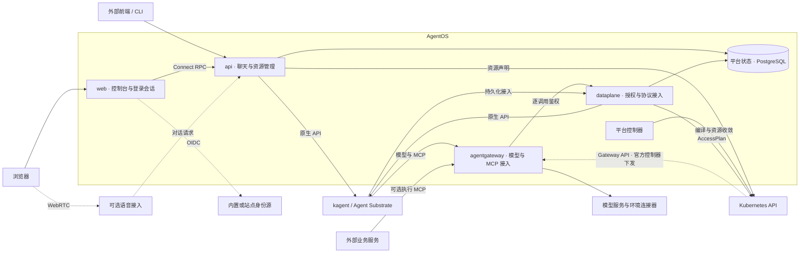

# 架构

AgentOS 是基于 kagent 的交互与接入层，提供 Web 控制台、输入增强、身份授权和模型与 MCP 接入。
Agent 执行、会话、任务持久化与原生 HITL 由 kagent 提供；业务 Agent、Skill、连接器和业务流程由方案包交付。

## 组件边界

| 组件 | 职责 |
| --- | --- |
| api | 控制台与管理 RPC、离线委派、环境 API 中转、方案包资源与语音会话 |
| dataplane | 网关鉴权、ExtMCP、TaskStore / Memory 接入、协作 MCP 与 Actor 公钥转发 |
| web | React 控制台、oauth2-proxy 登录会话与 MCP App 沙箱页 |
| identity | 密码模式的 oidc-provider 身份源 |
| 平台控制器 | 编译 AccessPlan、维护 Preset，加载 kagent 可选模块收敛模型与 MCP 连接 |
| agentgateway | 使用官方 Chart，承载模型与 MCP 路由、身份映射和 ExtMCP |
| Agent 运行时 | kagent 与 Agent Substrate，提供执行、原生状态、HITL 和协作 API |
| voice worker | 可选的 LiveKit Agents 组件，提供听写、朗读与通话 |

api 与 dataplane 使用同一镜像，分别配置 Service、NetworkPolicy 和 ServiceAccount。
运行时来源与构建见 [kagent](../runtime/kagent/README.md)和 [Substrate](../runtime/substrate/README.md)。

## 状态与资源

kagent 保存会话、消息、任务、工具调用、HITL 及委派续接状态。平台 PostgreSQL 保存执行绑定与加密离线凭据。
控制台按绑定筛选可见会话，直接读取 kagent 分页 API，组装执行树、搜索结果与列表分页。
打开的会话通过原生 A2A 任务流接收更新，并定期读取原生状态以发现新任务。

管理 API 保存原生连接声明及凭据 Secret。平台控制器加载 kagent 的可选 agentgateway 模块，
维护 ModelConfig、RemoteMCPServer、MCP 路由及平台提供的认证策略。
模型参数与授权策略由平台配置；官方 agentgateway 控制器读取 Gateway API 与 agentgateway 资源，经 xDS 下发代理配置。
Preset 更新未修改的预置，用户编辑后的资源归用户维护，详见 [Kubernetes 控制器](kubernetes-controller.md)。
团队知识复用原生 MemoryService 和嵌入模型，生成模型与向量模型通过原生用途声明区分。

## 执行与扩展

聊天通过 `entryAgent` 进入统一助手，再经原生协作 API 委派其他 Agent。
每次工具调用校验发起人、会话及父链权限、Agent 工具绑定与环境身份范围；原生持久化身份通过 kagent 验证。
工具确认与用户提问使用 kagent HITL，控制台展示请求并提交回复，恢复执行前复验当前授权。
取消经 A2A 覆盖执行与委派树；删除会话撤销对应绑定及后代授权。细节见[执行授权](execution-authorization.md)。

MCP Apps 由连接器提供，在独立源沙箱中运行，取数以当前查看者身份授权，见[对话视图](mcp-app.md)。
语音与 OpenTelemetry 按站点配置启用，见[语音](speech.md)和[遥测](delivery.md#遥测)。
外部服务通过可选的 `/mcp/executions` 运行、查询和取消任务；业务审批、事件、调度与持久化工作流由业务服务管理，见[扩展契约](extension.md)。
