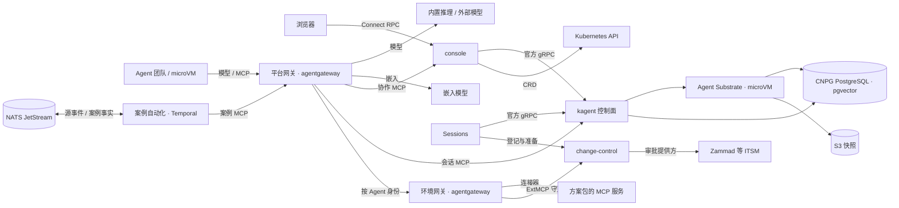

# 架构

## 组件

| 层 | 组件 | 来源 | 职责 |
| --- | --- | --- | --- |
| 底座 | kagent 控制面 | 上游 1.0.0-alpha11 与固定补丁 | Agent 编译为不可变 revision，会话与 A2A 历史、原生 HITL、MemoryService、会话 MCP |
| 底座 | Agent Substrate | 上游 0.5.0-alpha2 与固定补丁 | 每会话一个 Actor，Cloud Hypervisor microVM 隔离，快照与按目标主机注入凭据 |
| 底座 | agentgateway | 上游 v1.6.0 官方 Chart | 平台网关与环境网关：模型接入、MCP 汇聚、身份映射、读写视图、ExtMCP |
| 平台服务 | console | 本仓库 | 聊天、任务协作画布、工具调用与审批状态，团队、Skill、知识、连接、Harness 与环境管理 |
| 平台服务 | team-sessions | 本仓库 | 协作 MCP：委派、续接、知识检索、角色起草；写调用的审批协调 |
| 平台服务 | 测评作业 | 本仓库 | 按冻结基线在隔离副本中比较候选与已发布配置，评分写入 Langfuse 原生实验 |
| 环境侧 | change-control | 本仓库 | 写操作方案登记、审批核验、执行准备与原子放行；审批提供方可替换 |
| 环境侧 | 案例自动化 | 本仓库 | 把源 CloudEvents 映射为版本化案例，以 Temporal 工作流交协调者处理；发布案例事实，受理人工反馈与测评回报 |
| 平台资源 | 嵌入模型 | Ollama 与 EmbeddingGemma | 团队知识的 768 维向量 |
| 存储 | CNPG PostgreSQL、S3 | 上游 | kagent 与 Substrate 状态、记忆向量、Actor 快照 |

平台 API 在同一进程提供管理接口、协作 MCP、会话续接与治理协调，共享原生 A2A 读模型。change-control 在目标运维环境单独运行。依赖方向固定为平台服务调用 kagent，Agent 只经网关访问平台服务与环境，
控制台不在 Agent 的执行路径上。

## 调用链路

- 对话与委派：控制台以官方 gRPC 与入口 Agent 对话；入口 Agent 只能经 `delegate_coordinator` 把任务交给协调角色，协调角色经 `list_agents`、
  `create_session` 与 `dispatch_session` 安排其他成员。委派复用 kagent 原生会话，续接使用确定性 messageId 与原生幂等；kagent 原生子 Agent
  就绪后移除续接适配。
- 工具访问：Agent 的模型与 MCP 请求只到平台网关，凭据由 Substrate 按目标主机注入。环境工具经环境网关，网关按 Agent 身份选择后端凭据，
  把调用映射到目标系统中该 Agent 的账号；目标系统原生权限决定上限。
- 写操作治理：工具按分级声明为读或写，未知工具按写处理。写调用以 kagent 原生 HITL 暂停；team-sessions 向 change-control 登记不可变方案，
  由审批提供方建单并等待有审批角色的人员决定；批准后准备执行，恢复任务；环境网关在 `tools/call` 前经 ExtMCP 交 change-control 核验审批与审批人
  原生角色，并原子占用一次执行权；结果回写工单。治理模式为直接执行的环境跳过审批，按原生身份权限执行并保留调用记录。
- 团队知识：知识角色以带向量记忆的 Harness 写入原生 MemoryService；其他成员经 `search_knowledge` 只读检索，范围与服务用户由服务端固定。
- 轨迹：每条消息、委派、工具调用与审批都在 A2A 任务历史中，控制台据此绘制协作画布，不另建 trace 存储。

任务列表按操作树的状态和参与成员筛选，分页游标绑定完整筛选条件。顶栏待审批入口定位到任务与原生审批记录，工单决定仍在审批系统完成。
停止操作取消树中所有未结束的前台任务，后台任务继续运行；已执行的副作用保留在原生历史中，仍需核验。控制台和案例自动化共用取消逻辑，
续接器遇到已取消的前台任务时停止自动续接。运行时间线使用 vis-timeline，执行、委派与审批区间直接来自原生时间戳，缺失时间不推断。

## 部署形态

| 形态 | 平台 | 环境侧 |
| --- | --- | --- |
| 独立 | 单独的集群或虚机，一个平台接入多套环境 | 每套环境部署环境网关、change-control、审批系统与方案包的连接器 |
| 内嵌 | 目标集群中的独立命名空间 | 同上，与平台同集群 |

平台需要有 KVM 的节点运行 microVM。平台 Chart 包含单一 API、平台网关资源、嵌入模型、Harness、Skill 目录与系统 Agent；
环境套件包含环境网关、change-control 与凭据模板；kagent、Substrate、agentgateway 与 CNPG 由部署脚本以固定版本安装。
测评作业与案例自动化以镜像随平台发布：前者由平台 API 在测评命名空间以 Job 运行，后者在环境侧按需部署，依赖 NATS JetStream 与 Temporal。

## 安全边界

- Agent 运行在 microVM 中，出站按目标主机默认拒绝；模型与 MCP 凭据由 Substrate 注入，运行时拿不到明文。
- 平台网关以 SHA-256 哈希校验服务密钥，后端凭据只在 Secret；NetworkPolicy 只放行声明的调用方。
- 每个 Agent 在每个目标系统有独立账号，平台访问策略、目标系统账号权限与人工审批分别承担调用授权、实际权限上限与执行确认。
- 控制台页面和 RPC 直接访问，工作空间操作与管理开放；审批身份来自审批系统自己的登录，不经 Agent 转述。模型网关、MCP 和目标系统使用独立机器凭据。
- 执行凭证、审批账号密钥不进入提示词与浏览器响应；链路不承诺跨审批系统、数据库与目标系统的分布式事务，执行后故障须查询核验实际结果。

## 观测与测评

Langfuse 使用官方 Helm Chart，独立 PostgreSQL、ClickHouse、Valkey 与对象存储。原生 OTel 经过 Collector 的属性白名单后接入 Langfuse；消息内容与原始 API 请求体默认关闭。Web 以预置运维账号共享会话，采集使用项目 API Key。部署入口为 `deploy/observability.yaml`。

测评契约定义于 `proto/agentos/evaluation/v1`。候选快照、Job、分数完整性与回归检查使用原生 Kubernetes 持久化；配置编辑先经过原有命令校验，再形成候选资源。
测评作业读取固定版本的 Langfuse 数据集，按重复次数执行已发布与候选配置；基线规则按名称选择内置或方案包注册的评分器，逐例分数写入原生实验，报告经平台回报所属环境。
控制台按规则展示双方均值与差值，判定仍要求每个用例、每轮评分满足门槛与退化上限；单例错误与双方追踪链接随报告展示，追踪地址由 Langfuse 官方 SDK 生成。

案例自动化按方案包的 `CaseTrigger` 映射源事件：同一案例复用原生会话与确定性 messageId，超时取消并升级，事实类型的命名空间由方案包决定。
评分器与触发器契约见[扩展契约](extension.md#测评)。环境侧部署接线由[目标架构 Issue](https://github.com/pood1e/agentos-platform/issues/6) 跟踪。
