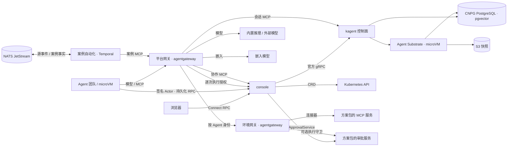

# 架构

聊天的语音输入与朗读由平台的可选 ASR/TTS 接入提供，能力查询、音频请求沿用控制台身份和来源校验。
前端按能力挂载 assistant-ui 官方适配器和控件；转写进入原输入框，发送与执行继续使用既有会话及 OBO 链路。
模型推理由站点独立部署，平台以标准音频接口调用，配置见[构建与部署](delivery.md#语音)。
实时通话使用 LiveKit 的音频与轮次管理，复用原聊天入口和执行授权，接线见[实时语音](voice-calls.md)。

## 组件

| 层 | 组件 | 来源 | 职责 |
| --- | --- | --- | --- |
| 底座 | kagent 控制面 | 上游 1.0.0-alpha17 与固定补丁 | Agent 编译为不可变 revision，会话与 A2A 历史、原生 HITL、MemoryService、会话 MCP |
| 底座 | Agent Substrate | 上游 0.6.0-alpha3 与固定补丁 | 每会话一个 Actor，Cloud Hypervisor microVM 隔离，快照与按目标主机注入凭据 |
| 底座 | agentgateway | 上游 v1.6.0 官方 Chart | 平台网关与环境网关：模型接入、MCP 汇聚、身份映射、读写视图、ExtMCP |
| 平台服务 | console | 本仓库 | 聊天、任务协作画布、工具调用与审批状态，团队、Skill、知识、连接、Harness 与环境管理 |
| 平台服务 | team-sessions | 本仓库 | 协作 MCP：委派、续接、知识检索、角色起草；可选外部审批协调 |
| 环境侧 | 案例自动化 | 本仓库 | 把源 CloudEvents 映射为版本化案例，以 Temporal 工作流交指定 Agent 处理；发布案例事实，受理人工反馈 |
| 平台资源 | 嵌入模型 | Ollama 与 EmbeddingGemma | 团队知识的 768 维向量 |
| 存储 | CNPG PostgreSQL、S3 | 上游 | kagent 与 Substrate 状态、记忆向量、Actor 快照 |

平台 API 在同一进程提供管理接口、协作 MCP、会话续接与治理协调，共享原生 A2A 读模型。业务审批、方案与执行守卫由方案包独立部署。依赖方向固定为平台服务调用 kagent，Agent 只经网关访问平台服务与环境，
平台授权服务处于工具执行路径，控制台页面通过 RPC 管理和观察任务。

审批协调与嵌套 HITL 续接通过 pg-boss 复用执行 PostgreSQL。队列仅保存原生任务、交互和子任务引用，
以工作空间及稳定业务键限制并发；读模型在入队成功后确认进度，失败保留待确认变更，启动时从原生状态补齐任务。
业务等待使用延迟任务，错误使用组件原生退避和死信；延迟入队与当前任务确认在同一数据库事务提交。
每次处理重新核验执行授权，原生回复使用确定性 messageId，外部审批按任务与工具引用幂等。

## 调用链路

- 对话与协作：普通聊天统一通过 `entryAgent` 进入，用户历史按发起人隔离。助手经 `list_agents`、`create_session`、原生 `invoke_session` 或异步 `dispatch_session` 委派专业 Agent，目标直接使用 kagent 资源引用。重试与续接复用原生会话和确定性 messageId。
- 委派契约：同步与后台委派共用 `session_id`、`message_id`、`message` 三个输入字段；平台构造原生 A2A 用户消息。角色由 Agent 的 `template.ref` 决定，工具上限绑定该模板，资源标签不参与角色授权。
- 工具访问：Agent 的模型与 MCP 请求只到平台网关，凭据由 Substrate 按目标主机注入。环境工具经环境网关，平台逐次校验用户、会话和 Agent 工具权限；环境按显式执行类型选择用户 OBO 或服务身份，目标系统原生权限决定资源上限。
- 工具确认：声明需要确认的调用以 kagent 原生 HITL 暂停。默认由控制台提交精确工具 ID 的批准或拒绝；配置外部 `ApprovalService` 后，由服务决定、准备执行并接收结果，控制台展示状态和链接。外部服务不可用时保留暂停。同一次暂停的工具使用同一类决定来源。
- 团队知识：知识角色以带向量记忆的 Harness 写入原生 MemoryService；其他成员经 `search_knowledge` 只读检索，范围与服务用户由服务端固定。
- 轨迹：每条消息、委派、工具调用与审批都在 A2A 任务历史中，控制台据此绘制协作画布，不另建 trace 存储。

任务列表按操作树的状态、参与成员和标签筛选，分页游标绑定完整筛选条件。标签仅从当前用户可见的操作根任务汇总。顶栏待审批入口定位到任务与原生审批记录，原生确认在控制台完成，外部审批在对应服务完成。
停止操作取消树中所有未结束的前台任务，并撤销该会话及后代的工具执行权限；已执行的副作用保留在原生历史中，仍需核验。控制台和案例自动化共用取消逻辑，
续接器遇到已取消的前台任务时停止自动续接。运行时间线使用 vis-timeline，执行、委派与审批区间直接来自原生时间戳，缺失时间不推断。

## 部署形态

| 形态 | 平台 | 环境侧 |
| --- | --- | --- |
| 独立 | 单独的集群或虚机，一个平台接入多套环境 | 每套环境部署环境网关与方案包连接器，按需接入业务审批与执行守卫 |
| 内嵌 | 目标集群中的独立命名空间 | 同上，与平台同集群 |

平台需要有 KVM 的节点运行 microVM。平台 Chart 包含单一 API、平台网关资源、嵌入模型、Harness、Skill 目录与系统 Agent；
环境套件通过 `agentos-environment` 与 `agentos-connections` 两个 Chart 管理环境网关和平台预置接入；kagent、Substrate、agentgateway 与 CNPG 由部署脚本以固定版本安装。
平台 API 使用滚动更新，新实例就绪后才移除旧实例；HTTP/2 连接通过 GOAWAY 排空已接收的 RPC。发布脚本在应用更新完成后刷新平台协作工具目录，保持网关与原生工具发现一致。
浏览器以鉴权心跳判断平台连接，单个资源或观测流失败保留在对应页面。空闲观测流每 15 秒发送心跳，并在 5 分钟后正常轮换；断网恢复时重新订阅，登录失效时重新认证并保留当前 URL。
案例自动化以镜像随平台发布，在环境侧按需部署，依赖 NATS JetStream 与 Temporal。

## 安全边界

- Agent 运行在 microVM 中，出站按目标主机默认拒绝；模型与 MCP 凭据由 Substrate 注入，运行时拿不到明文。
- 平台网关验证短期 Actor JWT 与 Kubernetes 绑定 ServiceAccount 令牌。模型请求按 Agent 的模型配置和 API 校验，MCP 调用按当前模板与具体服务工具绑定校验；发现令牌仅用于元数据。后端凭据存于 Secret，NetworkPolicy 只放行声明的调用方。
- 每个 Agent 在每个目标系统有独立账号，平台访问策略、目标系统账号权限与人工审批分别承担调用授权、实际权限上限与执行确认。
- 控制台按站点选择开放访问或 OIDC 登录。OIDC 模式通过 openid-client 完成授权码与 PKCE 登录，RPC 验证签名、issuer、audience 和角色；认证用户可聊天及发起只读查询，平台资源配置使用独立应用角色，目标写角色决定运维写上限。离线授权加密存于服务端，浏览器退出后后台任务仍可续期并保持原用户权限上限；会话取消撤销整条委派链，审批不扩大权限。目标系统支持时采用原生 OBO，其余连接器通过逐次授权的服务身份桥接。
- 执行凭证、审批账号密钥不进入提示词与浏览器响应；外部审批链路不承诺跨审批系统、数据库与目标系统的分布式事务，执行后故障须查询核验实际结果。

执行身份、会话隔离、运行时入口和环境 OBO 接线见[执行授权](execution-authorization.md)；逐资源业务授权的后续范围见[实施计划](authorization-plan.md)。

## 执行记录与自动化

可选遥测复用 kagent 原生 OpenTelemetry SDK，以 OTLP 将控制面和 Agent 运行时的信号发送到站点提供的接收端。
Traces、metrics、logs 分别配置，默认关闭导出与内容采集，接线见[遥测](delivery.md#遥测)。

案例自动化按方案包的 `CaseTrigger` 映射源事件并选择原生 Agent：同一案例复用原生会话与确定性 messageId，超时取消并升级，事实类型的命名空间由方案包决定。
聊天使用 assistant-ui，A2A 委派关联的任务在聊天右侧展示协作、MCP 服务调用和时间线；`/chat/:contextId?task=<taskId>` 可定位聊天及执行详情。消息按原始 A2A 顺序投影为带稳定 ID 的内容片段，保留过程说明、并行工具调用和最终答复的交错顺序；工具结果按调用 ID 更新原卡片。过程与草稿映射为 reasoning，完成后的最终答复映射为 text；官方朗读动作仅获取最终答复，再经 remark 转为可朗读文本。系统任务位于 `/system-tasks/:scheduleId?`，所有具有平台管理能力的管理员共享定义和执行历史，普通用户不可读取；执行详情通过 `/system-tasks?task=<taskId>` 在系统任务页内展开，复用聊天的执行详情组件。定时任务复用 kagent `ScheduledRunService` 持久化、调度和记录运行历史；配置维护和手动触发要求 `tasks.manage`。
每次定时运行通过原生执行记录核对会话、创建者和 Agent 后绑定独立只读服务主体；首次任务落盘前使用消息 ID 查找原生执行记录，ID 本身不授予权限。
聊天与协作创建请求的幂等键分别按发起人和父会话派生，重试保持稳定，并与系统任务的创建空间隔离。
方案预置只在首次接入时创建，用户编辑和删除状态由 kagent 保留。事件入口的启用状态来自平台配置，来源环境负责投递与 worker 运行。
触发器契约见[扩展契约](extension.md#案例自动化)。环境侧部署接线由[目标架构 Issue](https://github.com/pood1e/agentos-platform/issues/6) 跟踪。
