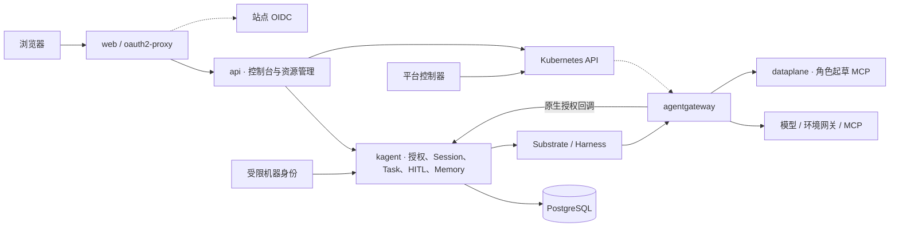

# 架构

AgentOS 是 kagent 的交互与接入层。平台提供控制台、连接管理、方案展示和可选语音；kagent 提供执行、授权、持久化、协作与记忆。

## 组件与状态

| 组件 | 职责 |
| --- | --- |
| api | 控制台与管理 RPC、原生执行投影、委托授权入口、MCP Apps 与可选语音会话 |
| dataplane | `8080` 角色起草 MCP、AccessPlan 工具目录与健康检查 |
| web | React 控制台、oauth2-proxy 登录与 MCP App 沙箱 |
| 平台控制器 | AccessPlan / Preset 收敛、原生模型与 MCP 连接配置 |
| agentgateway | 原生 JWT、模型与 MCP 路由、已选工具授权、目标凭据交换与 TLS |
| kagent | 身份验证、资源准入、Session/Task 归属、并发派发、委派树与取消、持久凭据、团队记忆 |
| Substrate / Harness | Actor 隔离、原生出站策略、运行时执行和统一工具事件 |
| voice worker | 可选 LiveKit Agents 输入、朗读与通话 |

api 与 dataplane 使用独立 ServiceAccount 和 NetworkPolicy。平台业务配置存于 Kubernetes；执行状态、授权上限和加密 OAuth2 凭据存于 kagent PostgreSQL。
运行时由 [kagent fork](https://github.com/pood1e/kagent/tree/main) 与 [Substrate fork](https://github.com/pood1e/substrate/tree/agentos/v0.6.0-alpha3) 发布，Chart 固定镜像摘要。

## 原生执行与投影

API 将请求的 Bearer 凭据传给 kagent。kagent 返回规范主体、能力和 Session 授权，并在资源读取、执行、HITL 续接和运行时凭据出口重新校验。
控制台直接消费原生分页、A2A 流与可信 `TaskExecution` 的根、父、关系和续接引用。停止只提交一次原生取消请求，子任务传播由 kagent 持久化推进。
工具状态读取统一 `ToolResponse`，执行状态读取原生 Task；后台委派使用 `invoke_session(background=true)`。

Agent 以 `harnessRef` 与可选 `modelConfigRef` 选择运行时；单次原生 CAS 更新同时切换两者，共享 AgentTemplate 维护可复用行为。实际内置工具、兼容性与依赖就绪状态由原生编译结果提供。

`standard` Harness 执行 `AgentTemplate.workflowFrom` 引用的声明式工作流。文档中的 `template:model` 与 `template:tools` 分别使用模板模型及已授权 MCP 绑定；CEL、并行分析与工具调用由原生运行时编排。工作流与指令通过方案 Preset 中同命名空间的 ConfigMap 发布。
协作 MCP 直接连接 kagent `/mcp`；角色起草使用平台业务 MCP。团队知识通过原生 `MemoryService` 的团队范围和服务端嵌入读写。

环境连接、MCP Apps 与语音分别见[环境接入](environments.md)、[MCP Apps](mcp-app.md)和[语音](speech.md)。执行身份见[执行授权](execution-authorization.md)，源码入口见[代码导航](code-navigation.md)。
