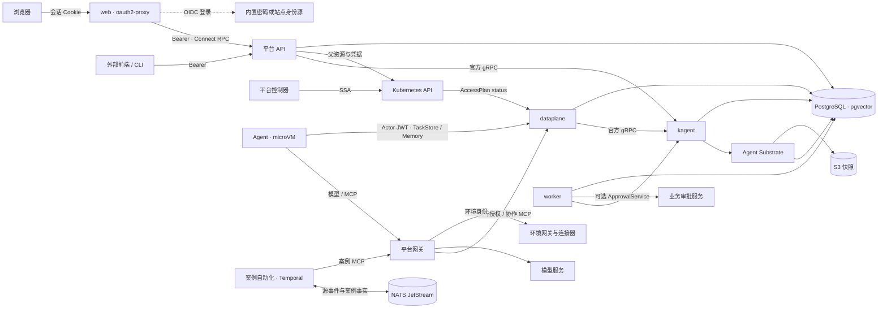

# 架构

AgentOS 基于 kagent、Agent Substrate 与 agentgateway，提供 Agent 团队运行、工具治理、知识和控制台。
业务 Agent、Skill、环境连接器与审批服务由方案包交付。

## 组件

| 组件 | 来源 | 职责 |
| --- | --- | --- |
| kagent | 1.0.0-alpha17 与固定补丁 | Agent revision、原生会话与 A2A 历史、HITL、MemoryService、会话 MCP |
| Agent Substrate | 0.6.0-alpha3 与固定补丁 | 每会话一个 Actor、Cloud Hypervisor microVM、快照与目标凭据注入 |
| agentgateway | v1.6.0 官方 Chart | 平台和环境网关、模型接入、MCP 路由、身份映射与 ExtMCP |
| api | 本仓库 | 聊天与管理 RPC、离线委派、环境 API 中转、方案包资源与语音会话 |
| dataplane | 本仓库 | 网关外部鉴权、ExtMCP、TaskStore 与 Memory 代理、协作 MCP、Actor 公钥 |
| worker | 本仓库 | 外部审批协调、嵌套续接、kagent 对账与方案预置 |
| web | nginx 与 oauth2-proxy | 静态前端、浏览器会话、访问令牌转发与 MCP App 沙箱页 |
| identity | oidc-provider | 密码模式身份源，为站点共享主体签发令牌 |
| 平台控制器 | controller-runtime 与官方 Kubernetes 类型 | 编译 AccessPlan、维护连接派生对象与方案预置 |
| 团队知识 | 原生 MemoryService、Ollama 与 EmbeddingGemma | 共享知识及 768 维向量检索 |
| 案例自动化 | Temporal 与 NATS JetStream | 在环境侧映射事件、调用指定 Agent、处理超时与人工反馈 |

api、dataplane 与 worker 使用同一镜像，各自配置 Service、NetworkPolicy 与最小权限 ServiceAccount；Agent 只经网关与运行时控制面访问 dataplane。
运行时补丁与回归范围见 [kagent](../runtime/kagent/README.md)和 [Substrate](../runtime/substrate/README.md)。

## 状态与一致性

原始会话、消息、工具调用与审批由 kagent 保存。平台在同一 PostgreSQL 中维护执行绑定、加密凭据、任务标签、读投影与协调队列。

读投影按列保存任务、会话、发起人及执行树。dataplane 的 TaskStore 代理在原生写入成功后更新投影，
api 和协作 MCP 写入各自产生的变更；worker 通过持久化水位对账补齐 kagent 侧变化，首次接入回填历史。
列表在 SQL 中完成归属过滤、搜索、标签筛选与分页，详情按执行树加载；委派关系取自任务 ID 和确定性 messageId。

同一执行树的摘要在事务锁内重算，提交后经 `pg_notify` 唤醒各 api 副本的订阅；NOTIFY 心跳确认送达，中断后重新订阅并刷新观测流。
文本增量由被查看会话的 A2A 订阅提供。原生状态与紧凑投影分别承担执行记录和查询职责。

审批协调与续接使用 pg-boss，各进程在投影写入的同一事务入队，worker 消费，以工作空间及稳定业务键限制并发。
每次处理重新核验执行授权，原生回复使用确定性 messageId，外部审批按任务与工具引用幂等。
组件负责延迟、退避和死信，恢复入口见[后台协调](delivery.md#后台协调)。

管理 API 写入原生连接父对象，再保存其拥有的凭据 Secret。控制器以 SSA 维护 ModelConfig、RemoteMCPServer、路由与认证策略，
通过状态条件报告就绪或失败；凭据保存失败后可重试收敛。
Preset 首次应用方案资源，后续更新由 SSA 所有权决定；用户编辑后取得对象所有权，方案升级保留其修改与删除结果。
资源归属见 [Kubernetes 控制器](kubernetes-controller.md)。

团队知识清理以完整记录 ID 集合的 ETag 确认快照，逐条删除该快照中的记录。
生成模型与向量模型使用原生资源用途声明，配置和执行均校验用途。

## 执行与授权

- 聊天通过 `entryAgent` 进入统一助手，再经 A2A 委派专业 Agent。同步与后台委派共用原生会话、消息 ID 和消息契约。
- 用户身份、会话及父链、Agent 工具绑定和环境身份共同决定权限上限。控制器编译 AccessPlan，运行时在每次调用时读取就绪决策并核验当前执行身份。
- Agent 在 microVM 中运行，出站按目标 origin 放行，宿主注入短期 Actor JWT。平台逐次验证签名、受众、当前 Actor UID 与 Session。
- 平台 API 校验 Bearer 令牌的签名、issuer、audience 与角色；浏览器会话由 web 管理。后台任务使用加密持久化的离线授权，账号与身份提供方决定续期有效性。
- 模型与 MCP 入口分别校验 Actor 或绑定 ServiceAccount 身份。工作负载 TokenReview、目标凭据和 NetworkPolicy 共同限定调用范围。
- 工具确认使用原生 HITL。外部 ApprovalService 可承担业务决定、执行准备与结果记录，平台在各阶段复验原执行授权。
- 取消经原生 A2A 覆盖当前执行及其委派树，并等待终态确认；删除会话撤销绑定及后代授权。外部副作用由原生历史和目标系统核验。

角色、凭据生命周期与会话隔离见[执行授权](execution-authorization.md)，环境 OBO 接线见[环境接入](environments.md)。

## 控制台与自动化

聊天使用 assistant-ui，按原始 A2A 顺序展示过程、并行工具调用、审批与最终答复。
子 Agent 完成后在委派位置展示结果，工具调用按稳定调用 ID 更新；个人任务在聊天中展示。

MCP Apps 由环境 MCP 服务交付单文件 HTML，在独立源沙箱中运行。
宿主校验来源会话、服务、可见性与只读分级，再以当前查看者身份访问环境网关，接入见[对话视图](mcp-app.md)。
语音输入、朗读和 LiveKit 通话复用聊天与执行授权，配置见[语音](speech.md)。

系统任务在 `/system-tasks/:scheduleId?` 展示共享定义与运行历史，读取要求平台管理能力，维护与手动触发要求 `tasks.manage`。
定时任务由 kagent ScheduledRunService 持久化和调度，每次运行核对原生执行记录后绑定独立只读服务主体。
方案预置保留用户编辑的启停、周期与历史；外部判定可决定启动或跳过一次执行，权限单独绑定至预置任务。

案例自动化在环境侧运行，以版本化 CloudEvents 映射源事件，同一案例复用会话和确定性 messageId，
超时取消并升级。触发器、结果读取与外部审批契约见[扩展契约](extension.md)。

## 部署与观测

平台可独立部署或位于目标集群的专用命名空间，每个平台接入多套环境。
KVM 节点承载 microVM；CNPG 与 S3 保存数据库和快照。kagent、Substrate、agentgateway 与 CNPG 由参考部署按固定版本安装。
平台和环境 Chart 声明控制器、AccessPlan 与 Preset，Gateway API HTTPRoute 暴露 web、API 及可选沙箱主机名。

平台进程滚动更新在新实例就绪后排空旧实例的 HTTP/2 连接。dataplane 至少两副本并配置 PodDisruptionBudget；
worker 多副本时由 PostgreSQL 会话锁选出对账实例，会话命令以咨询锁跨 api 副本互斥。观测流每 15 秒发送心跳、5 分钟轮换，浏览器恢复连接后重新订阅。
kagent 原生 OpenTelemetry 通过 OTLP 接入站点接收端，默认关闭导出与内容采集；平台进程以 OpenTelemetry Node SDK 输出授权耗时、kagent 请求与进程资源指标。

制品、签名、站点变量和部署步骤见[构建与部署](delivery.md)。
