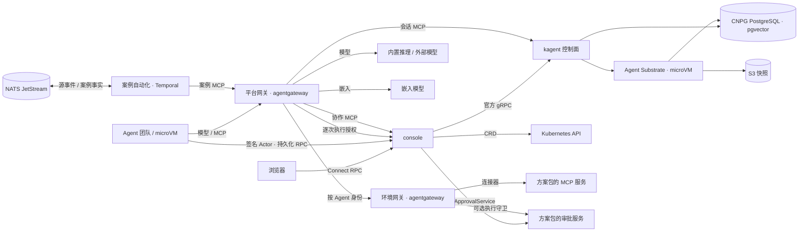

# 架构

## 组件

| 层 | 组件 | 来源 | 职责 |
| --- | --- | --- | --- |
| 底座 | kagent 控制面 | 上游 1.0.0-alpha11 与固定补丁 | Agent 编译为不可变 revision，会话与 A2A 历史、原生 HITL、MemoryService、会话 MCP |
| 底座 | Agent Substrate | 上游 0.5.0-alpha2 与固定补丁 | 每会话一个 Actor，Cloud Hypervisor microVM 隔离，快照与按目标主机注入凭据 |
| 底座 | agentgateway | 上游 v1.6.0 官方 Chart | 平台网关与环境网关：模型接入、MCP 汇聚、身份映射、读写视图、ExtMCP |
| 平台服务 | console | 本仓库 | 聊天、任务协作画布、工具调用与审批状态，团队、Skill、知识、连接、Harness 与环境管理 |
| 平台服务 | team-sessions | 本仓库 | 协作 MCP：委派、续接、知识检索、角色起草；可选外部审批协调 |
| 平台服务 | 测评作业 | 本仓库 | 按冻结基线在隔离副本中比较候选与已发布配置，评分写入 Langfuse 原生实验 |
| 环境侧 | 案例自动化 | 本仓库 | 把源 CloudEvents 映射为版本化案例，以 Temporal 工作流交指定 Agent 处理；发布案例事实，受理人工反馈与测评回报 |
| 平台资源 | 嵌入模型 | Ollama 与 EmbeddingGemma | 团队知识的 768 维向量 |
| 存储 | CNPG PostgreSQL、S3 | 上游 | kagent 与 Substrate 状态、记忆向量、Actor 快照 |

平台 API 在同一进程提供管理接口、协作 MCP、会话续接与治理协调，共享原生 A2A 读模型。业务审批、方案与执行守卫由方案包独立部署。依赖方向固定为平台服务调用 kagent，Agent 只经网关访问平台服务与环境，
平台授权服务处于工具执行路径，控制台页面通过 RPC 管理和观察任务。

## 调用链路

- 对话与协作：普通聊天统一通过 `entryAgent` 进入，用户历史按发起人隔离。助手经 `list_agents`、`create_session`、原生 `invoke_session` 或异步 `dispatch_session` 委派专业 Agent，目标直接使用 kagent 资源引用。重试与续接复用原生会话和确定性 messageId。
- 工具访问：Agent 的模型与 MCP 请求只到平台网关，凭据由 Substrate 按目标主机注入。环境工具经环境网关，平台逐次校验用户、会话和 Agent 工具权限；环境按显式执行类型选择用户 OBO 或服务身份，目标系统原生权限决定资源上限。
- 工具确认：声明需要确认的调用以 kagent 原生 HITL 暂停。默认由控制台提交精确工具 ID 的批准或拒绝；配置外部 `ApprovalService` 后，由服务决定、准备执行并接收结果，控制台展示状态和链接。外部服务不可用时保留暂停。同一次暂停的工具使用同一类决定来源。
- 团队知识：知识角色以带向量记忆的 Harness 写入原生 MemoryService；其他成员经 `search_knowledge` 只读检索，范围与服务用户由服务端固定。
- 轨迹：每条消息、委派、工具调用与审批都在 A2A 任务历史中，控制台据此绘制协作画布，不另建 trace 存储。

任务列表按操作树的状态和参与成员筛选，分页游标绑定完整筛选条件。顶栏待审批入口定位到任务与原生审批记录，原生确认在控制台完成，外部审批在对应服务完成。
停止操作取消树中所有未结束的前台任务，并撤销该会话及后代的工具执行权限；已执行的副作用保留在原生历史中，仍需核验。控制台和案例自动化共用取消逻辑，
续接器遇到已取消的前台任务时停止自动续接。运行时间线使用 vis-timeline，执行、委派与审批区间直接来自原生时间戳，缺失时间不推断。

## 部署形态

| 形态 | 平台 | 环境侧 |
| --- | --- | --- |
| 独立 | 单独的集群或虚机，一个平台接入多套环境 | 每套环境部署环境网关与方案包连接器，按需接入业务审批与执行守卫 |
| 内嵌 | 目标集群中的独立命名空间 | 同上，与平台同集群 |

平台需要有 KVM 的节点运行 microVM。平台 Chart 包含单一 API、平台网关资源、嵌入模型、Harness、Skill 目录与系统 Agent；
环境套件包含环境网关、身份路由与凭据模板；kagent、Substrate、agentgateway 与 CNPG 由部署脚本以固定版本安装。
测评作业与案例自动化以镜像随平台发布：前者由平台 API 在测评命名空间以 Job 运行，后者在环境侧按需部署，依赖 NATS JetStream 与 Temporal。

## 安全边界

- Agent 运行在 microVM 中，出站按目标主机默认拒绝；模型与 MCP 凭据由 Substrate 注入，运行时拿不到明文。
- 平台网关以 SHA-256 哈希校验服务密钥，后端凭据只在 Secret；NetworkPolicy 只放行声明的调用方。
- 每个 Agent 在每个目标系统有独立账号，平台访问策略、目标系统账号权限与人工审批分别承担调用授权、实际权限上限与执行确认。
- 控制台按站点选择开放访问或 OIDC 登录。OIDC 模式使用 OAuth2 Proxy，RPC 独立验证签名、issuer、audience 和角色；认证用户可聊天及发起只读查询，平台资源配置使用独立应用角色，目标写角色决定运维写上限。用户身份随会话、委派和后台任务传递，审批不扩大权限。目标系统支持时采用原生 OBO，其余连接器通过逐次授权的服务身份桥接。
- 执行凭证、审批账号密钥不进入提示词与浏览器响应；外部审批链路不承诺跨审批系统、数据库与目标系统的分布式事务，执行后故障须查询核验实际结果。

执行身份、会话隔离、运行时入口和环境 OBO 接线见[执行授权](execution-authorization.md)；逐资源业务授权的后续范围见[实施计划](authorization-plan.md)。

## 观测与测评

Langfuse 使用官方 Helm Chart，独立 PostgreSQL、ClickHouse、Valkey 与对象存储。原生 OTel 经过 Collector 的属性白名单后接入 Langfuse；消息内容与原始 API 请求体默认关闭。Web 以预置运维账号共享会话，采集使用项目 API Key。部署入口为 `deploy/observability.yaml`。

测评契约定义于 `proto/agentos/evaluation/v1`。候选快照、Job、分数完整性与回归检查使用原生 Kubernetes 持久化；配置编辑先经过原有命令校验，再形成候选资源。
测评作业读取固定版本的 Langfuse 数据集，按重复次数执行已发布与候选配置；基线规则按名称选择内置或方案包注册的评分器，逐例分数写入原生实验，报告经平台回报所属环境。
控制台按规则展示双方均值与差值，判定仍要求每个用例、每轮评分满足门槛与退化上限；单例错误与双方追踪链接随报告展示，追踪地址由 Langfuse 官方 SDK 生成。

案例自动化按方案包的 `CaseTrigger` 映射源事件并选择原生 Agent：同一案例复用原生会话与确定性 messageId，超时取消并升级，事实类型的命名空间由方案包决定。
评分器与触发器契约见[扩展契约](extension.md#测评)。环境侧部署接线由[目标架构 Issue](https://github.com/pood1e/agentos-platform/issues/6) 跟踪。
