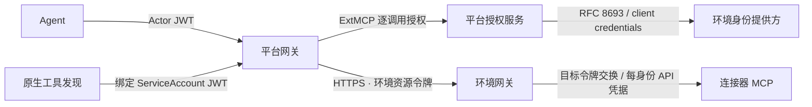

# 环境接入

环境套件在目标集群部署 HTTPS 环境网关与身份路由，在平台登记环境资源、信任根及读写工具视图。目标系统、MCP 连接器、身份提供方与目标账号由方案包和站点提供。AgentOS 展示 Agent、工具连接、执行与原生 HITL，业务门户和审批由所属环境管理。



## 组成

`agentos-environment` Chart 在目标集群部署环境网关、证书声明、身份路由和网络策略；`agentos-connections` Chart 在平台工作空间登记环境 CA、准入配置、服务目录与身份视图。
参考部署的环境剧本、站点变量与身份变更流程随站点发行版提供。

配置取自方案 Chart 的 `global.agentos`，环境治理、工具分级与身份档案只维护一份。保留身份 `catalog` 只用于服务工具发现。
客户端 `agentos-<identity>` 的标识与密钥分别保存在平台 `<environment>-<identity>` 和环境网关同名身份 Secret 中，键为 `client-id`、`client-secret`。
环境与连接 Chart 声明 AccessPlan，控制器统一编译工具范围和原生派生资源。Preset 从编译结果补齐默认工具绑定；原生控制器负责发现与刷新，逐调用授权见[执行授权](execution-authorization.md)。

环境令牌的 audience 为 `gateway_resource`。平台网关使用原生 HTTP 外部鉴权为每次上游请求设置令牌，包括初始化通知、SSE 建连与会话清理；ExtMCP 单独校验工具授权。用户执行请求采用 RFC 8693 并保留原用户 `sub`；服务执行和控制器发现采用 client credentials。外部鉴权由网关经 dataplane 的私有 h2c 端口 9090 调用。路径 `/mcp/<identity>/<service>` 校验 `azp == agentos-<identity>`。环境网关按 RFC 9728 发布受保护资源元数据。

原生控制器通过 `agentos.dev/discovery-auth: kubernetes` 的 RemoteMCPServer 使用可刷新绑定 ServiceAccount 凭据。发现请求保留 MCP 路径，统一发送到配置的平台网关，凭据仅在该网关使用，重定向终止。Agent 继续使用按服务隔离的地址与 Actor JWT。平台分别验证签发者、受众和控制器主体，工具调用额外校验执行绑定、权限上限和已选工具。

每个环境服务使用独立的 `<environment>-<service>-mcp-gateway` Service 地址，目录与身份视图共享该服务的 origin。RemoteMCPServer 地址、Service origin 与 Actor JWT audience 保持一致。

## 连接器契约

| 内容 | 约定 |
| --- | --- |
| MCP 服务 | 默认位于 `mcp` 命名空间，Pod 标签 `agentos.dev/component: mcp-server`，只接受环境网关流量 |
| 身份提供方 | HTTPS OIDC Discovery；每身份机密客户端支持 client credentials 与 RFC 8693 |
| OAuth 目标 | `auth.oauthTokenExchange` 消费环境令牌，签发目标 audience 的访问令牌 |
| API 令牌目标 | 每身份独立有限期凭据，存于环境 Secret，由方案包定期轮换 |

`environment_connectors` 使用 agentgateway 原生 BackendAuth。`<identity>`、`<environment>`、`<issuer>` 分别替换为身份、环境名与 issuer。`access` 可限制某目标的访问级别。同一服务内的目标采用同一类凭据消费方式。

```yaml
environment_connectors:
  kubernetes:
    targets:
      - host: kubernetes-mcp.mcp.svc.cluster.local
        port: 8000
        auth:
          oauthTokenExchange:
            url: <issuer>/protocol/openid-connect/token
            grantType: TokenExchange
            audiences: [<environment>-kubernetes]
            scopes: [kubernetes]
            subjectToken:
              source: {header: {name: Authorization, prefix: 'Bearer '}}
              tokenType: AccessToken
            clientAuth:
              clientId: agentos-<identity>
              method: ClientSecretBasic
              secretRef: {name: agentos-<identity>, key: client-secret}
  tickets:
    targets:
      - host: tickets-mcp.mcp.svc.cluster.local
        port: 8214
        path: /mcp
        auth:
          secretRef: {name: backend-<identity>, key: tickets}
          location: {header: {name: X-Ticket-Token}}
```

环境网关在转发前移除 Actor JWT；API 令牌路由同时移除环境 Authorization，OAuth 目标交换后只收到目标令牌。后端使用无状态 MCP 路由，每次请求独立选择凭据。

## 连接器收到的上下文

| 内容 | 标准与字段 |
| --- | --- |
| 追踪 | W3C Trace Context：`traceparent`、`tracestate` |
| 会话、任务与单次调用 | W3C Baggage：`gen_ai.conversation.id`、`a2a.task.id`、`gen_ai.tool.call.id`、`gen_ai.agent.name` |
| 发起人与执行身份 | 目标交换令牌的 `sub` 与 `azp`，签名、issuer、audience 和有效期由资源服务器验证 |

agentgateway 按 MCP SEP-414 将 W3C 上下文同步到 MCP `_meta`。Baggage 用于关联与幂等，身份以可验证令牌为准。API 令牌目标的原生审计记录服务账号，平台执行记录保留实际发起人。

## 资源归属与生命周期

目标环境每套一个 `agentos-environment` release，拥有证书声明、网关、身份路由和网络策略。平台工作空间只有一个 `agentos-connections` release，
拥有环境 AccessPlan 和 CA 声明，统一处理环境增删；控制器拥有派生连接。连接 release 在应用启动前发布 CA 与配置，原生 kagent 与 Substrate 基础设施须已就绪。

Chart 管理对象由 Helm 回收，预置连接在控制台只读。平台创建的连接、可编辑 AgentTemplate 与目标系统的凭据分别由平台、原生 kagent API 与环境管理。
未修改的 AgentTemplate 随 Preset 更新，用户编辑或取得所有权后保留修改与删除结果。
