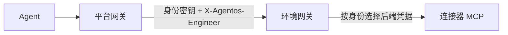

# 环境接入

环境套件把一套托管环境接入平台：在环境集群部署环境网关、连接器的身份路由，在平台集群登记环境连接与每个身份的工具视图。
目标系统、连接器 MCP 服务及其在目标系统中的账号由方案包或站点提供。

环境接入属于部署配置。AgentOS 展示智能体、工具连接、执行与审批；目标系统的门户和资源管理由所属环境提供。



## 组成

| 剧本 | 位置 | 内容 |
| --- | --- | --- |
| `environments/deploy.yaml` | 环境集群 | agentgateway、环境网关与身份密钥、每个身份每个服务的后端与路由 |
| `environments/connect.yaml` | 平台集群 | 环境连接 Secret `agentos-governance`、身份凭据、服务目录、读写工具视图与 RemoteMCPServer，预置角色的默认工具绑定，回收退出范围的身份 |

团队配置取自方案 Chart 的 `global.agentos`（见[扩展契约](extension.md#chart-入参)），环境的治理模式、工具分级与身份档案只维护一份。
身份 `catalog` 为平台保留，用于发现各服务的工具，须对每个服务有只读访问。

工具目录由 kagent 的原生 `RemoteMCPServer` 控制器发现与刷新；连接器地址、凭据引用、工具授权与审批策略来自方案配置。
发现结果用于描述可用工具，执行权限由环境网关和目标系统校验。

## 方案提供的内容

| 内容 | 约定 |
| --- | --- |
| 连接器 MCP 服务 | 部署在环境网关命名空间（默认 `mcp`），Pod 标签 `agentos.dev/component: mcp-server`，只接受环境网关的流量 |
| 后端凭据 | 每个身份在目标系统的账号凭据，以 Secret 存放在环境网关命名空间，名称与键由 `environment_connectors` 引用 |
| 外部审批服务 | 可选，方案包实现 `agentos.governance.v1.ApprovalService`，维护业务决定及其执行约束 |


`environment_connectors` 按服务描述环境网关的后端目标，`auth` 为 agentgateway 原生后端鉴权，`<identity>` 在渲染时替换为身份名；
`access` 限定目标只对指定访问级别生效。可选 `userAuth` 使用相同的原生 BackendAuth 结构声明用户委派，`<environment>` 替换为环境名；配置后按已授权的执行类型分别路由，凭证交换失败直接拒绝。接线与生命周期见[执行授权](execution-authorization.md)。

```yaml
environment_connectors:
  kubernetes:
    title: Kubernetes
    targets:
      - host: kubernetes-mcp.mcp.svc.cluster.local
        port: 8000
        auth: {secretRef: {name: backend-<identity>, key: kubernetes}}
  tickets:
    title: Tickets
    targets:
      - {host: tickets-mcp.mcp.svc.cluster.local, port: 8214, path: /mcp, protocol: SSE,
         auth: {secretRef: {name: backend-<identity>, key: tickets}, location: {header: {name: X-Ticket-Token}}}}
      - {name: tickets-write, access: [operate, manage], host: tickets-write-mcp.mcp.svc.cluster.local, port: 8000,
         auth: {secretRef: {name: tickets-api-<identity>, key: token}}}
```

## 连接器收到的上下文

环境网关转发前移除平台侧凭据：Actor JWT（`x-substrate-actor-token`）不进入连接器，用户令牌头（`x-agentos-subject-token`）只在配置 `userAuth` 的路由上由原生令牌交换消费。
连接器可读取的执行上下文均为标准格式：

| 内容 | 标准 | 字段 |
| --- | --- | --- |
| 追踪 | W3C Trace Context | `traceparent`、`tracestate`，与平台原生追踪同属一个 trace |
| 会话、任务与单次调用 | W3C Baggage，键名遵循 OpenTelemetry GenAI 语义约定 | `gen_ai.conversation.id`、`a2a.task.id`、`gen_ai.tool.call.id`、`gen_ai.agent.name` |
| 发起人 | RFC 8693 交换令牌 | `userAuth` 换取的 JWT，`sub` 为发起用户 |

agentgateway 按 MCP SEP-414 同时把 `traceparent`、`tracestate`、`baggage` 写入请求的 `_meta`。上述 Baggage 由 kagent 原生运行时写入，其他 Harness 取决于其 MCP 客户端，连接器按可选字段处理。
Baggage 用于关联与去重，例如以 `gen_ai.conversation.id` 与 `gen_ai.tool.call.id` 组合作为写操作的幂等键；可验证的发起人以交换令牌为准。

服务身份桥接的连接器需要在目标侧记录发起人时，`userAuth` 以 `oauthTokenExchange` 换取受众为该连接器的令牌，并以 `credentials` 携带目标系统的服务凭据；连接器按 OIDC 发现校验签名、issuer 与 audience。

## 站点变量

清单的 `environments` 组每台主机对应一套环境，`ansible_host` 为平台访问环境网关的地址：

| 主机变量 | 说明 |
| --- | --- |
| `environment_name` | 与 `global.agentos.environments` 中的名称一致 |
| `environment_kubeconfig` | 环境集群凭据，默认 `.cache/environments/<name>/kubeconfig.yaml` |
| `approval_service_url` | 可选，外部审批 Connect 服务地址；省略时使用原生人工确认 |
| `approval_service_authorization_file` | 可选，外部审批服务的 Authorization 内容文件，仅服务端使用 |

| 变量 | 说明 |
| --- | --- |
| `agentos_values_file` | 含 `global.agentos` 的方案 Chart 值文件 |
| `environment_connectors` | 连接器后端描述 |
| `platform_cidr` | 允许访问环境网关的平台地址段 |
| `gateway_rules` | 可选，环境网关额外放行的 CEL 表达式 |
| `registry_config_file` | 可选，Docker JSON，创建镜像拉取凭据 `agentos-registry` |

```sh
ANSIBLE_CONFIG=deploy/ansible.cfg .cache/deploy-venv/bin/ansible-playbook environments/deploy.yaml -i <site>/environments.yaml -e @<site>/environments-vars.yaml
ANSIBLE_CONFIG=deploy/ansible.cfg .cache/deploy-venv/bin/ansible-playbook environments/connect.yaml -i <site>/environments.yaml -e @<site>/environments-vars.yaml
```

环境网关密钥生成在 `.cache/environments/<name>/secrets/`，目录权限 0700，需纳入控制端备份。`deploy.yaml` 的标签为
`gateway`、`backends`。`connect.yaml` 初始化缺失的服务与预置角色的默认绑定，保留控制台中保存的服务配置与角色绑定。
