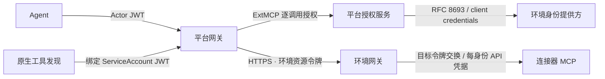

# 环境接入

环境套件在目标集群部署 HTTPS 环境网关与身份路由，在平台登记环境资源、信任根及读写工具视图。目标系统、MCP 连接器、身份提供方与目标账号由方案包和站点提供。AgentOS 展示智能体、工具连接、执行与审批，目标系统门户由所属环境管理。



## 组成与依赖

| 剧本 | 作用 |
| --- | --- |
| `environments/deploy.yaml` | 安装 cert-manager 与 agentgateway，签发网关证书、发布平台 CA，配置环境网关和身份路由 |
| `environments/connect.yaml` | 登记 `agentos-governance`、服务目录、身份工具视图与原生 RemoteMCPServer，初始化缺失的角色工具绑定 |

配置取自方案 Chart 的 `global.agentos`，环境治理、工具分级与身份档案只维护一份。保留身份 `catalog` 只用于服务工具发现。

方案包先配置环境 OIDC issuer、每身份客户端和目标凭据，再部署环境套件、平台应用和服务连接。平台应用挂载环境 CA，CA 必须在应用就绪前发布。客户端 `agentos-<identity>` 的标识与密钥分别保存在平台 `<environment>-<identity>` 和环境网关同名身份 Secret 中，键为 `client-id`、`client-secret`。

环境令牌的 audience 为 `gateway_resource`。平台网关使用原生 HTTP 外部鉴权为每次上游请求设置令牌，包括初始化通知、SSE 建连与会话清理；ExtMCP 单独校验工具授权。用户执行请求采用 RFC 8693 并保留原用户 `sub`；服务执行和控制器发现采用 client credentials。外部鉴权只由网关通过私有 h2c 端口 9090 调用。路径 `/mcp/<identity>/<service>` 校验 `azp == agentos-<identity>`。环境网关按 RFC 9728 发布受保护资源元数据。

原生控制器通过 `agentos.dev/discovery-auth: kubernetes` 的 RemoteMCPServer 使用可刷新绑定 ServiceAccount 凭据，只向配置的平台网关地址发送。平台验证签发者、受众和控制器 ServiceAccount 主体。Agent 的握手、发现和调用验证 Actor JWT，工具调用额外校验执行绑定、权限上限和已选工具。

## 连接器契约

| 内容 | 约定 |
| --- | --- |
| MCP 服务 | 默认位于 `mcp` 命名空间，Pod 标签 `agentos.dev/component: mcp-server`，只接受环境网关流量 |
| 身份提供方 | HTTPS OIDC Discovery；每身份机密客户端支持 client credentials 与 RFC 8693 |
| OAuth 目标 | `auth.oauthTokenExchange` 消费环境令牌，签发目标 audience 的访问令牌 |
| API 令牌目标 | 每身份独立有限期凭据，存于环境 Secret，由方案包定期轮换 |
| 外部审批 | 可选 proto `ApprovalService`；默认通过 catalog 环境令牌认证，服务端校验业务决定与执行约束 |

`environment_connectors` 使用 agentgateway 原生 BackendAuth。`<identity>`、`<environment>`、`<issuer>` 分别替换为身份、环境名与 issuer。`access` 可限制某目标的访问级别。同一服务内的目标采用同一类凭据消费方式。

```yaml
environment_connectors:
  kubernetes:
    targets:
      - host: kubernetes-mcp.mcp.svc.cluster.local
        port: 8000
        auth:
          oauthTokenExchange:
            url: <issuer>/protocol/openid-connect/token
            grantType: TokenExchange
            audiences: [<environment>-kubernetes]
            scopes: [kubernetes]
            subjectToken:
              source: {header: {name: Authorization, prefix: 'Bearer '}}
              tokenType: AccessToken
            clientAuth:
              clientId: agentos-<identity>
              method: ClientSecretBasic
              secretRef: {name: agentos-<identity>, key: client-secret}
  tickets:
    targets:
      - host: tickets-mcp.mcp.svc.cluster.local
        port: 8214
        path: /mcp
        auth:
          secretRef: {name: backend-<identity>, key: tickets}
          location: {header: {name: X-Ticket-Token}}
```

环境网关在转发前移除 Actor JWT；API 令牌路由同时移除环境 Authorization，OAuth 目标交换后只收到目标令牌。后端使用无状态 MCP 路由，每次请求独立选择凭据。

## 连接器收到的上下文

| 内容 | 标准与字段 |
| --- | --- |
| 追踪 | W3C Trace Context：`traceparent`、`tracestate` |
| 会话、任务与单次调用 | W3C Baggage：`gen_ai.conversation.id`、`a2a.task.id`、`gen_ai.tool.call.id`、`gen_ai.agent.name` |
| 发起人与执行身份 | 目标交换令牌的 `sub` 与 `azp`，签名、issuer、audience 和有效期由资源服务器验证 |

agentgateway 按 MCP SEP-414 将 W3C 上下文同步到 MCP `_meta`。Baggage 用于关联与幂等，身份以可验证令牌为准。API 令牌目标的原生审计记录服务账号，平台执行记录保留实际发起人。

## 站点变量

`environments` 组每台主机声明一套环境，`ansible_host` 为平台访问网关的地址。

| 变量 | 说明 |
| --- | --- |
| `environment_name` | 对应 `global.agentos.environments` |
| `environment_issuer` | HTTPS OIDC issuer |
| `environment_domain` | 网关 DNS 名称所属域 |
| `environment_kubeconfig` | 默认 `.cache/environments/<name>/kubeconfig.yaml` |
| `gateway_server_name` | 默认 `<environment>-mcp.<domain>`，用于证书 SAN 与上游 SNI |
| `gateway_resource` | 默认 `https://<gateway_server_name>:31000/mcp`，作为 OAuth audience |
| `agentos_values_file` | 包含 `global.agentos` 的方案 Chart 值文件 |
| `environment_connectors` | 连接器后端定义 |
| `platform_cidr` | 允许访问环境网关的平台地址段 |
| `platform_kubeconfig` | 平台集群访问配置 |
| `approval_service_url` | 可选，外部审批 HTTPS Connect 地址 |
| `registry_config_file` | 可选，镜像拉取凭据 Docker JSON |

```sh
ANSIBLE_CONFIG=deploy/ansible.cfg .cache/deploy-venv/bin/ansible-playbook environments/deploy.yaml -i <site>/environments.yaml -e @<site>/environments-vars.yaml
ANSIBLE_CONFIG=deploy/ansible.cfg .cache/deploy-venv/bin/ansible-playbook environments/connect.yaml -i <site>/environments.yaml -e @<site>/environments-vars.yaml
```

`connect.yaml` 初始化缺失的服务与预置角色默认绑定，保留控制台中保存的服务配置和角色绑定。原生 RemoteMCPServer 控制器负责工具发现与刷新；发现结果描述可用工具，执行权限由平台、环境网关与目标系统共同校验。
