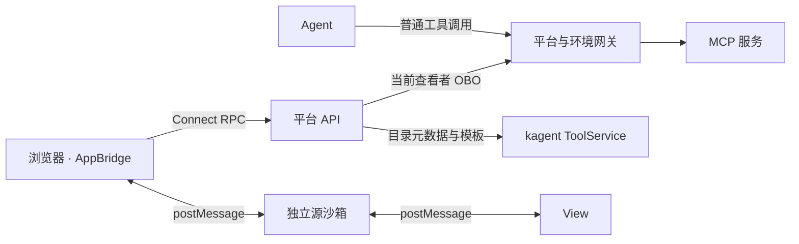

# 对话视图（MCP Apps）

连接器通过 MCP Apps 扩展 `io.modelcontextprotocol/ui` 提供工具元数据和单文件 HTML，平台在独立源沙箱中展示。

## 调用链路

Agent 调用展示工具后，控制台从原生任务还原其视图资源。浏览器展开卡片时加载模板，View 接收原工具入参与结果，后续取数通过宿主回调。
任务 ID 与调用 ID 标识视图实例，`ui://` URI 标识可复用模板；子 Agent 的视图随委派结果展示。

## 服务契约

| 内容 | 约定 |
| --- | --- |
| 展示工具 | `_meta.ui.resourceUri` 引用模板；只读，返回编号、数量、状态等摘要 |
| 取数工具 | `visibility: ["app"]`，列入方案包 `toolsets.readOnly` |
| 模板 | `ui://` 资源，MIME 为 `text/html;profile=mcp-app` |
| SDK | 服务端使用 `registerAppTool` / `registerAppResource`，View 使用官方扩展 SDK |

平台通过 kagent 的 `ListMCPAppTools` 与 `ReadMCPAppResource` 读取目录。
AccessPlan 编译器对目录路由开放模板与元数据，Agent 路由保留工具可见性和普通调用结果。
`ToolCall.ui_resource_uri` 投影为 assistant-ui 的 `mcp.app.resourceUri`，A2A 工具输出还原为 `CallToolResult`。

## 回调授权

| RPC | 行为 |
| --- | --- |
| `GetAppResource` | 按 `AppReference` 的任务 ID、调用 ID 校验归属，返回模板与 `_meta.ui` |
| `CallAppTool` | 校验同服务、`app` 可见性与只读工具分级，以当前查看者身份调用 |

回调使用查看者的最新凭证，按原调用 Agent 的环境身份交换令牌，访问环境网关 `/mcp/<identity>/<service>`。
服务主体和密码模式的共享主体使用环境服务凭据；地址、SNI 和 CA 取自环境连接。
目标写操作通过 Agent 工具调用与原生 HITL 执行。实现见 [服务](../server/mcp-apps/service.ts)与[回调客户端](../server/mcp-apps/client.ts)。

## 沙箱与宿主

站点配置 `route.hosts.sandbox`，web 在独立主机名提供 `/mcp-app-sandbox`。
宿主使用官方 `AppBridge` 与 `PostMessageTransport`，代理页和 iframe 双向校验消息来源。
视图共用沙箱源及存储，iframe 权限为 `allow-scripts allow-same-origin allow-forms`；CSP 使用规范默认值与控制台 `frame-ancestors`。
资源可显式申请 `data:` 静态内容与 HTTPS 图像源；站点在 `mcpApps.imageOrigins` 配置允许的图像源。脚本、连接和其他资源仍受沙箱策略限制，数据访问通过工具回调。

| 宿主能力 | 行为 |
| --- | --- |
| 工具输入、结果、取消与尺寸通知 | 同步桥接生命周期，限制内联高度 |
| `tools/call` | 调用 `CallAppTool` |
| `ui/open-link` | HTTP(S) 链接，新窗口使用 `noopener` |
| `ui/message` | 文本预填输入框，由用户发送 |
| 显示与上下文 | `inline` / `fullscreen`、主题、语言与规范样式变量 |

沙箱初始化或资源读取失败后提供重试；未配置沙箱时使用普通工具展示。
宿主封装见 [mcp-app-host.ts](../shared/browser/mcp-app-host.ts)，接入配置见[扩展契约](extension.md)。

## 验证与参考

回归覆盖模板、当前查看者凭据、服务与工具范围、沙箱消息来源，见 [MCP Apps 测试](../tests/mcp-apps.test.ts)与[客户端测试](../tests/mcp-app-client.test.ts)。
规范与 SDK：[MCP Apps](https://github.com/modelcontextprotocol/ext-apps)。
