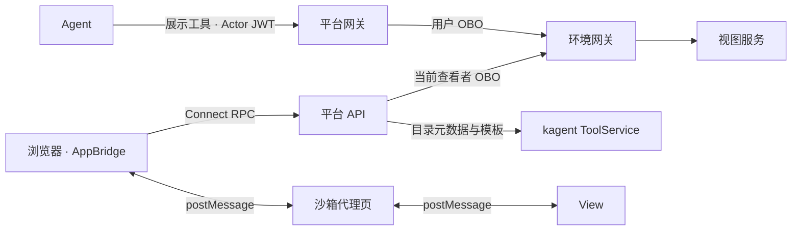

# 对话视图（MCP Apps）

环境 MCP 服务通过官方 MCP Apps 扩展 `io.modelcontextprotocol/ui` 提供视图，平台在独立源沙箱中渲染单文件 HTML。
工具元数据、模板和业务取数随 MCP 服务交付。

## 调用链路

1. Agent 通过普通工具授权链路调用展示工具。
2. 读投影记录工具的视图资源，浏览器经 `GetAppResource` 加载模板。
3. View 初始化后接收工具入参与结果，后续取数经宿主回调。

任务 ID 与调用 ID 标识独立视图实例，`ui://` URI 标识可复用模板。
卡片默认折叠，展开后加载；子 Agent 的视图随结果呈现。

## 元数据与资源

平台通过 kagent 的 `ListMCPAppTools` 与 `ReadMCPAppResource` 读取目录元数据和模板，
资源 MIME 为 `text/html;profile=mcp-app`。

AccessPlan 编译器在目录路由开放 `ui://` 资源，Agent 路由仅保留工具可见性与普通调用结果。
路由实现见 [平台编译器](../controller/internal/compile/platform.go)和[环境编译器](../controller/internal/compile/environment.go)。
kagent ADK 对带视图资源的工具使用展示提示，因此视图资源和 Agent 分析结果分别通过目录、执行路由交付。

`ToolCall.ui_resource_uri` 投影为 assistant-ui 的 `mcp.app.resourceUri`。
宿主将 A2A 中的工具输出重建为 `CallToolResult`，模板和视图元数据取自目录。

## 工具回调与授权

| RPC | 输入 | 行为 |
| --- | --- | --- |
| `GetAppResource` | `AppReference`：任务 ID、调用或审批工具 ID | 校验来源归属，返回模板 HTML 与 `_meta.ui` |
| `CallAppTool` | `AppReference`、工具名、参数 | 校验工具范围，以当前查看者身份调用来源服务 |

普通工具视图的回调同时满足：来源会话可读、目标属于同一服务、可见性包含 `app`、工具列入 `toolsets.readOnly`。
目标写操作通过 Agent 与原生 HITL 执行。仅 `app` 可见的工具用于视图取数，
Agent 编辑、模板保存和 Actor 调用分别校验工具可见性。

回调以当前查看者的最新凭证换取原调用 Agent 身份的环境令牌，直接访问环境网关 `/mcp/<identity>/<service>`。
服务主体和密码模式的共享主体采用环境服务凭据。网关地址、端口、TLS 服务名和 CA 来自环境连接。
实现见 [MCP Apps 服务](../server/mcp-apps/service.ts)与[回调客户端](../server/mcp-apps/client.ts)。

## 沙箱与宿主

站点配置 `route.hosts.sandbox`，web 镜像在该主机名提供 `/mcp-app-sandbox`。
沙箱源与控制台独立，视图共用沙箱源及其存储空间。

宿主使用官方 `AppBridge` 与 `PostMessageTransport`。
代理页校验控制台源，内层 iframe 使用 `allow-scripts allow-same-origin allow-forms`，消息双向校验来源。
CSP 使用规范默认限制与控制台 `frame-ancestors`；资源声明仅接受 `resourceDomains` 中的 `data:`。
视图的数据访问统一经工具回调。

| 宿主能力 | 行为 |
| --- | --- |
| 初始化、工具输入、结果、取消和尺寸通知 | 维护桥接生命周期，限制内联高度 |
| `tools/call` | 调用 `CallAppTool` |
| `ui/open-link` | 仅接受 HTTP(S)，新窗口使用 `noopener` |
| `ui/message` | 文本预填输入框，由用户发送 |
| 显示模式 | `inline`、`fullscreen` |
| 宿主上下文 | 主题、语言、显示模式与规范样式变量 |

资源缓存为 1 分钟，RPC 超时 20 秒并自动重试一次；沙箱初始化超时 10 秒，失败后释放桥接并提供重试。
沙箱主机名为空时，工具以普通图标展示。共享宿主代码见 [mcp-app-host.ts](../shared/browser/mcp-app-host.ts)。

## 视图服务

服务端使用 MCP Apps 的 `registerAppTool`、`registerAppResource` 或对应语言 SDK，
View 使用官方扩展 SDK 构建为单文件 HTML。

| 工具类型 | 元数据 | 内容 |
| --- | --- | --- |
| 展示工具 | `_meta.ui.resourceUri` | 只读、包含可复现查询条件，返回编号、数量、状态等简短结果 |
| 取数工具 | `visibility: ["app"]` | 只读，返回 View 所需数据 |

服务持续提供 `_meta.ui`，由目录路由和宿主处理能力协商。
方案包配置连接器、工具分级、身份范围、Skill 展示时机和图标，契约见[扩展契约](extension.md#对话视图)。

## 外部审批视图

`Approval.app` 声明展示工具与入参，平台将任务和审批工具绑定为 `AppReference`，复用相同宿主。
审批提供方在 `EnvironmentConnection.approval_url` 根路径提供 MCP HTTP 服务，
宿主使用当前查看者的 `catalog` OBO 令牌，并将已校验的 `ApprovalReference` 注入 `_meta["agentos.dev/approval"]`。

审批写回调声明 `visibility: ["app"]` 与 `readOnlyHint: false`。
平台逐次校验查看者的写权限和原任务仍等待同一审批；提供方校验人员资格、工单版本与审计身份。
审批决定和后续执行校验由环境 ApprovalService 管理。

## 验证与参考

持续回归覆盖模板读取、当前查看者凭据、服务与工具范围、沙箱消息来源和审批复验，
入口见 [MCP Apps 测试](../tests/mcp-apps.test.ts)、[客户端测试](../tests/mcp-app-client.test.ts)与[审批视图测试](../tests/approval-apps.test.ts)。

- [MCP Apps 规范 2026-01-26](https://github.com/modelcontextprotocol/ext-apps/blob/main/specification/2026-01-26/apps.mdx)
- [官方 SDK 与参考宿主](https://github.com/modelcontextprotocol/ext-apps)
- [agentgateway MCP Apps 支持](https://github.com/agentgateway/agentgateway/blob/v1.6.0/crates/agentgateway/src/mcp/apps.rs)
