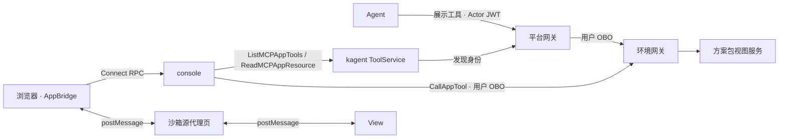

# 对话视图（MCP Apps）

聊天中的拓扑、指标等交互视图采用 MCP 官方扩展 MCP Apps（`io.modelcontextprotocol/ui`，规范 2026-01-26）。方案包在自有 MCP 服务的工具上声明 `ui://` 视图资源；
平台作为通用宿主，在独立源的沙箱中渲染视图并代理视图发起的工具调用。平台不内置业务组件，也不在控制台加载方案包脚本。

平台宿主已实现；方案包视图按本文的 MCP Apps 契约独立交付。

## 选型

| 方案 | 结论 |
| --- | --- |
| MCP Apps | 采用。视图随 MCP 服务交付，可在 Claude、ChatGPT、VS Code 等宿主复用；kagent 与 agentgateway 已支持 |
| 声明式组件目录（A2UI、assistant-ui generative-ui） | 不采用。组件由宿主实现，业务视图需进入平台 |
| 前端插件（Module Federation 等） | 不采用。方案包脚本与控制台同源，可访问用户会话与原生审批，并与前端依赖版本耦合 |
| AG-UI | 不适用。属于 Agent 与前端之间的事件协议，平台沿用 A2A 与 Connect RPC |

## 上游能力

| 组件 | 能力 | 平台使用 |
| --- | --- | --- |
| kagent 1.0.0-alpha17 ADK | 协商 UI 扩展；对模型隐藏仅 `app` 可见的工具；App 工具结果对模型替换为已展示提示 | 使用可见性过滤；Agent 路由不下发 `resourceUri`，结果照常进入模型 |
| kagent ToolService | `ListMCPAppTools`、`ReadMCPAppResource`、`CallMCPAppTool` | 前两者提供元数据与模板；`CallMCPAppTool` 以控制器发现身份调用，不携带用户身份，不使用 |
| agentgateway v1.6.0 | 保留 `_meta.ui`；多路复用时改写 `ui://`；资源未授权时移除 `resourceUri`、保留 `visibility` | 目录路由放行 `ui://` 资源，Agent 路由保持拒绝 |
| `@modelcontextprotocol/ext-apps` 2.x | 宿主侧 `AppBridge`、`PostMessageTransport`，视图侧 `App` 与 React hooks；与平台的 MCP SDK 2.x 同代 | 控制台宿主桥接、方案包视图 |
| assistant-ui 0.15 | 工具片段的 `mcp.app` 元数据与独立分组 | 消息布局 |

assistant-ui 内置的 `McpAppRenderer` 固定从 `scf.auiusercontent.com` 加载沙箱，`@mcp-ui/client` 7.x 依赖 MCP SDK 1.x，均不引入。

## 架构

1. Agent 调用展示工具，链路与授权同普通工具调用。
2. 读模型投影工具调用时标记其视图资源；浏览器经 `GetAppResource` 取得模板，交由沙箱代理加载。
3. View 初始化后，宿主推送工具入参与结果；View 经宿主调用同一服务的取数工具。

每次展示调用以任务 ID 和调用 ID 标识独立视图实例；相同 `ui://` 地址表示复用模板。后续查询和展示保留已有实例，图内刷新仅更新当前实例。

## 平台

### 元数据与模板

控制台对各环境服务的目录 RemoteMCPServer（`<environment>-<service>`）调用 `ListMCPAppTools`，缓存工具的视图资源 URI 与可见性；
模板经 `ReadMCPAppResource` 读取并短期缓存，URI 按目录返回值原样使用。资源 MIME 须为 `text/html;profile=mcp-app`。

`ui://` 资源只在目录路由放行：

| 位置 | 变更 |
| --- | --- |
| `server/authorization/mcp.ts` | `discoveryMethods` 增加 `resources/read`，仅接受 `ui://` URI |
| `charts/agentos-connections/templates/catalog.yaml` | 目录路由的 MCP 授权增加 `mcp.resource.name` 以 `ui://` 开头的规则 |
| `charts/agentos-environment/templates/backends.yaml` | 同上，仅限 `catalog` 身份 |

Agent 使用的身份路由（`identity-views.yaml` 与环境侧其他身份）保持拒绝，agentgateway 在这些路由上移除 `resourceUri`、保留 `visibility`。
kagent 会把带 `resourceUri` 的工具结果对模型替换为已展示提示；`query_prometheus` 这类同时用于分析与展示的工具若在 Agent 路由暴露视图，模型将拿不到查询结果。
按上述划分，模型照常获得结果，仅 `app` 可见的工具仍对模型隐藏，控制台按目录元数据渲染视图。

### 消息投影

- `agentos.execution.v1.ToolCall` 增加 `ui_resource_uri`，由读模型按工具来源填写。
- 前端映射为 assistant-ui 工具片段的 `mcp.app.resourceUri`；`groupPartByType` 增加 `standalone-tool-call`，App 调用在工具图标行之外渲染。
- App 调用以卡片呈现，默认折叠，展开后加载 View；子 Agent 的 App 调用随 `AgentResult` 呈现。
- kagent Harness（adk-go）的工具结果仅保留 `{output}`（`structuredContent` 或文本），MCP `content` 与 `_meta` 不进入 A2A 历史。
  宿主据此重建 `CallToolResult`，View 不依赖结果 `_meta`。

### 渲染与沙箱

- `shared/browser/mcp-app-host.ts` 使用官方 `AppBridge` 与 `PostMessageTransport` 管理桥接生命周期。代理就绪后下发模板，View 初始化后依次推送 `tool-input` 与 `tool-result`，调用终止时推送 `tool-cancelled`。
- 折叠卡片展开后才加载资源。浏览器以任务和调用引用缓存资源 1 分钟，RPC 超时为 20 秒，暂时故障自动重试一次；沙箱初始化超时为 10 秒，失败后关闭桥接并提供重试按钮。
- 沙箱代理部署在独立源。平台 Chart 增加 `ingress.sandbox.host` 与 `ingress.sandbox.tlsSecret`，控制台仅在该主机名下提供代理页；建议使用与控制台不同的注册域。
- 代理页参照 ext-apps 参考宿主：校验嵌入方为控制台源，创建内层 iframe（`allow-scripts allow-same-origin allow-forms`），双向转发并校验消息来源。
- 代理页以 HTTP 头下发 CSP，取规范的限制性默认值并附加 `frame-ancestors <控制台源>`。`_meta.ui.csp` 只接受 `resourceDomains` 中的 `data:`，不授予网络来源、`permissions` 与 `domain`。
- 未配置沙箱主机名时不渲染 View，工具调用按现有图标展示。

### 视图工具调用

新增 Connect RPC：

| RPC | 输入 | 行为 |
| --- | --- | --- |
| `GetAppResource` | `AppReference`（任务 ID、调用或审批工具 ID） | 校验当前用户可读该来源，返回模板 HTML 与 `_meta.ui` |
| `CallAppTool` | `AppReference`、工具名、参数 | 校验后以当前用户身份调用来源服务的工具，返回 `CallToolResult` |

`CallAppTool` 的校验：

| 项 | 规则 |
| --- | --- |
| 归属 | 当前用户可读原调用所在会话 |
| 服务 | 目标工具与原调用属于同一服务 |
| 可见性 | `visibility` 包含 `app` |
| 分级 | 工具在 `toolsets` 中为只读级别；写操作只能由 Agent 发起并经原生确认 |

执行时以当前用户的最新凭证经 RFC 8693 换取原调用 Agent 身份的环境令牌，直接调用环境网关 `/mcp/<identity>/<service>`。
环境网关端点（地址、端口与 TLS 服务名）加入 `EnvironmentConnection`，由 `agentos-connections` 从同一份 `environments[].gateway` 生成；
TLS 复用控制台已挂载的 `<environment>-gateway-ca`。无用户访问令牌时（`identity.mode: none`）使用环境身份的服务凭证，与该模式下的 Agent 调用一致。
目标系统支持 OBO 时记录实际用户，其余目标由平台记录发起人、服务与工具。

kagent 的 `CallMCPAppTool` 经平台网关以控制器发现身份调用，ExtMCP 拒绝无 Actor 的 `tools/call`；放开该路径会绕过逐用户授权。

### 可见性

仅 `app` 可见的工具在 `toolsets` 中列为 `readOnly`；未列入的工具按写处理，视图不可调用。
kagent ADK 已对模型隐藏此类工具，平台对其他 Harness 不作假设：Agent 编辑器不提供此类工具，模板保存校验拒绝绑定，ExtMCP 拒绝 Actor 调用。

### 宿主能力

| 方法 | 支持 |
| --- | --- |
| `ui/initialize`、`tool-input`、`tool-result`、`tool-cancelled`、`size-changed` | 支持；内联高度设上限 |
| `tools/call` | 经 `CallAppTool` |
| `ui/open-link` | 仅 `http(s)`，新窗口打开并设置 `noopener` |
| `ui/message` | 文本预填到输入框，由用户发送 |
| `ui/request-display-mode` | `inline`、`fullscreen` |
| `resources/read`、`ui/update-model-context`、sampling、文件下载 | 不声明 |

`hostContext` 提供 `theme`、`locale`、`displayMode` 与 `styles.variables`；样式变量由 shadcn 设计令牌映射到规范的标准变量名，View 通过 `useHostStyles` 跟随主题。

## 方案包

上游连接器已提供视图时直接使用；否则由方案包自有的 MCP 服务提供，作为环境连接器部署，上游连接器不改造。服务端可使用 ext-apps 的
`registerAppTool`、`registerAppResource`（TypeScript）或 FastMCP 的 `AppConfig`（Python）；View 使用 `@modelcontextprotocol/ext-apps` 构建为单文件 HTML。

| 工具类型 | `_meta.ui` | 约束 |
| --- | --- | --- |
| 展示工具 | `resourceUri` | 只读；参数包含绝对时间等可复现条件；返回简短文本 `content` 与少量 `structuredContent` |
| 取数工具 | `visibility: ["app"]` | 只读；返回 View 所需的完整数据 |

- 展示工具的结果进入模型上下文：只返回编号、数量与状态等简短文本，不含用户可写的自由文本；大体量数据仅经取数工具返回。
- View 在规范默认 CSP 下运行：不访问外部域，不使用 `eval` 与 Worker，数据仅经 `tools/call` 获取。
- 服务始终输出 `_meta.ui`，不按客户端能力判断：环境网关的无状态路由可能以网关自身的 initialize 初始化上游，其中不含扩展声明。
- 接入项：`environments` 连接器与按身份注入的目标凭据、`toolsets`（全部 `readOnly`）、`identities`（`read`）、Skill 中的展示时机、`pack.json` 工具图标。

AIOps 方案包示例：

| 视图 | 提供方 | 工具 |
| --- | --- | --- |
| 指标 | 上游 mcp-grafana 2.1.0 及以上 | `query_prometheus`（展示与刷新共用） |
| 拓扑 | 方案包服务，接收 Agent 提供的关系与指标快照，或查询 CMDB 适配器 | `show_topology`（展示）、`topology_graph`（取数） |
| 工单 | 方案包服务，数据来自 Zammad | `show_tickets`（展示）、`ticket_search`、`ticket_detail`（取数） |

## 安全

- 沙箱源与控制台不同源，View 无法访问控制台的 Cookie、存储与 DOM；代理按来源转发消息。
- 所有 View 共用沙箱源，View 之间不做存储隔离。
- View 没有直接网络出口；数据访问经 `CallAppTool` 的归属、服务、可见性与分级校验，并受目标系统的用户权限约束。
- 工具调用产生的 View 仅允许只读回调；消息回调仅预填输入框。

## 外部审批视图

`ApprovalService` 的 `Approval.app` 可声明展示工具与入参。平台将任务和工具 ID 绑定为 `AppReference` 的审批来源，在审批卡片内复用相同的沙箱宿主；原始工具来源仍使用 `call_id`。

审批提供方在 `EnvironmentConnection.approval_url` 的根路径提供 MCP HTTP 服务，Connect RPC 使用服务方法路径。平台从该服务发现展示工具、读取视图，并以当前查看者的 `catalog` OBO 令牌调用回调。
宿主将已校验的 `ApprovalReference` 注入 MCP `_meta["agentos.dev/approval"]`，提供方据此限定工单和操作范围。

审批写回调声明 `visibility: ["app"]` 与 `readOnlyHint: false`。平台在每次写入前校验查看者的写权限和原生任务仍等待同一审批；提供方校验当前人员资格、工单版本和审计身份。
审批决定与后续执行校验仍由环境 `ApprovalService` 管理，普通工具视图的写权限保持关闭。平台不定义工单字段或审批成员组。

## 实施与验证

| 项 | 状态 |
| --- | --- |
| 目录路由放行 `ui://`；`ListMCPAppTools`、`ReadMCPAppResource` 端到端验证；Agent 路由仍移除 `resourceUri` | 已实现；使用原生 kagent 与两层 agentgateway 1.6.0 验证 |
| `ToolCall.ui_resource_uri`、`GetAppResource`、`CallAppTool`、`EnvironmentConnection` 网关端点 | 已实现；覆盖资源归属、当前查看者凭证与 Agent 身份 |
| 沙箱主机名、代理页与 CSP | 已实现；Chart 与 HTTP 隔离测试覆盖 |
| 控制台宿主组件，聊天与子 Agent 结果中的渲染 | 已实现；覆盖无正文子结果与续跑前的 App 调用 |
| 仅 `app` 可见工具的绑定与调用限制 | 已实现；目录、模板保存与 Actor 授权均校验 |
| fake kagent 录制 App 调用；e2e 覆盖渲染、主题、回调、跨服务与写工具拒绝 | 已实现；官方 View SDK 经双层 iframe 验证 |
| AIOps 视图服务 | 由 aiops-mvp 的 `mcp-apps-impl.md` 跟踪 |

[扩展契约](extension.md#对话视图)登记对话视图扩展点，契约即 MCP Apps 规范。

## 参考

- [MCP Apps 规范 2026-01-26](https://github.com/modelcontextprotocol/ext-apps/blob/main/specification/2026-01-26/apps.mdx)
- [ext-apps SDK 与参考宿主](https://github.com/modelcontextprotocol/ext-apps)
- [agentgateway MCP Apps 支持](https://github.com/agentgateway/agentgateway/blob/v1.6.0/crates/agentgateway/src/mcp/apps.rs)
- [assistant-ui MCP Apps](https://www.assistant-ui.com/docs/tools/mcp-apps)
