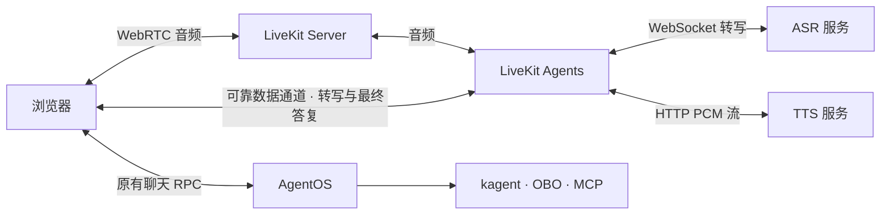

# 语音

语音能力按站点启用。听写与朗读使用平台 ASR / TTS 接口，实时通话使用 LiveKit Agents 与官方浏览器组件。

## 模型服务

模型接入页的“语音模型”分别管理转写和语音合成；聊天页按能力显示麦克风和助手回答的朗读控件。
模型管理权限允许修改服务地址、模型、语言、音色与访问密钥，保存后用于新请求。
配置相应语音服务后，前端启用对应入口。

聊天录音通过 Deepgram Live 兼容的 `WS /v1/listen` 持续发送音频和接收中间、最终转写结果。
转写 `protocol: PROTOCOL_WHISPERLIVEKIT` 接入原生 `/asr`，平台将完整草稿映射为浏览器流式结果，保留模型的分词和空格。
平台使用官方 Deepgram SDK 与 WebSocket 组件，音频请求沿用平台 API 的 Bearer 校验，模型凭据由服务端持有。

文件转写接口使用 `POST /v1/audio/transcriptions`（multipart 文件上传、JSON 文本响应），TTS 服务提供
`POST /v1/audio/speech`（`model`、`voice`、`input`、`response_format: mp3`，返回音频）。
合成 `protocol: PROTOCOL_NEMO` 接入 NeMo-Speech.cpp HTTP 服务，使用 WAV 和音色对应的语言参数。
合成语言优先匹配非拉丁正文，再匹配完整文本；中文、阿拉伯语内嵌的英文术语沿用正文音色，未匹配时使用首个音色。
模型和音色由站点提供，服务可以与文本模型同机部署；文件转写和语音合成使用 OpenAI SDK。

`languageCodes` 声明转写服务支持的语言，聊天页显示语言选择，初始选择匹配界面语言，之后记住用户选择。
选择自动识别时省略语言参数；代理仅转发配置内的语言代码。
语音合成 RPC 使用服务器流返回音频；支持对应 MediaSource 格式的浏览器收到首段即可播放，其他格式由浏览器完整解码后播放。
录音期间文本作为完整草稿更新；停止后显示尾部处理状态，可取消，等待上限为 15 秒，已识别文字保留。

### 配置

```yaml
speech:
  transcription:
    endpoint:
      baseUrl: https://speech.example.test/v1
    model: multilingual-asr
    languageCodes: [zh, en, ar]
  synthesis:
    endpoint:
      baseUrl: https://speech.example.test/v1
    voices:
      - {languageCode: zh, model: tts-zh, voice: default}
      - {languageCode: en, model: tts-en, voice: default}
      - {languageCode: ar, model: tts-ar, voice: default}
  secretRef: speech-credentials
```

方案 Chart 的初始配置位于 `app_values.agentos.speech`。仅启用一项时，另一项保留 `{}`。
Preset 首次创建 `<release>-speech` Secret，用户在模型管理页保存后取得对象所有权，后续预置升级保留配置与凭据。
配置与凭据在同一 Secret 中按 `resourceVersion` 原子更新；并发编辑冲突需刷新后重新保存。
合成配置至少包含一个音色，每种语言配置一个模型和音色；平台按文本语言选择，首项作为无法识别时的默认值。
语言代码使用 ISO 639，重复语言被拒绝；语音语言独立于界面语言。
`secretRef` 可省略；配置时引用已有 Kubernetes Secret，启用转写需要 `transcription-api-key`，启用合成需要
`synthesis-api-key`。管理接口只返回密钥是否配置；留空保留原密钥，显式清除会停止使用引用密钥。
开发环境通过 `AGENTOS_SPEECH_SECRET` 指定设置 Secret 的名称，默认 `<release>-speech`；
`configuration.json` 使用 `SpeechConfiguration` 的 proto JSON。

## 浏览器接入

浏览器适配器通过 `@agentos/contracts/shared/browser/` 发布。原生控制台复用同一套听写、PCM 流播放和通话桥接，注入已有 RPC 客户端、身份作用域与聊天发送／取消函数；转写 WebSocket 地址由接入方提供。前端按 `GetSpeechCapabilities` 展示入口，VAD 资源部署在 `/speech-vad/`。

录音使用浏览器 MediaRecorder，需 HTTPS 或 localhost 与麦克风授权；每次最多 60 秒、1 MiB。
采集保留回声消除，关闭浏览器降噪和自动增益，减少对识别音素和音量包络的改写。
中间转写在录音期间持续更新输入框，停止录音后提交尾部音频，最终文本由用户发送。
朗读最多 8,000 字符、返回音频最多 16 MiB；模型请求期限为 60 秒。每个控制台实例最多四路并发录音。
切换对话会取消录音和播放。音频仅在请求期间保留于内存。
密码模式与外部 OIDC 使用相同授权路径；只读用户可使用语音，目标系统写权限由执行授权决定。

- 听写：Silero VAD 在持续静音 1.4 秒后停止录音，排空转写尾部，将结果保留在输入框。无语音 12 秒或总录音 60 秒时结束。
- 朗读：仅发送最终答复正文。NeMo 以 22050 Hz、单声道 PCM16LE 逐块返回；浏览器在音频时钟上连续排程，保留跨网络块的采样与首尾音频。

## 实时通话



### 交互

- 通话：用户加入私有房间后连续交谈；LiveKit 管理 VAD 和轮次，浏览器将已确认转写交给原聊天入口。检测到持续 200 毫秒的人声时，通过官方 `AgentSession.interrupt()` 停止播放，并取消对应聊天任务及全部委派。旧答复停止朗读；下一句话在取消确认后进入同一会话。最终正文经可靠数据通道交给语音服务流式合成。
- 通话期间关闭普通录音与朗读；切换会话、身份、页面或挂断时释放麦克风与房间。首轮产生聊天 ID 时继续当前通话。发送失败显示显式重试，并复用消息 ID。
- 每次通话最长 30 分钟，默认并发上限为 4。浏览器 45 秒内未加入时回收房间。

### 身份与部署

`StartVoiceCall` 与 `EndVoiceCall` 使用平台 API 的 Bearer 身份校验。内部语音 API 使用独立服务令牌；浏览器只取得绑定单个房间的短期 LiveKit 令牌。
模型凭据与用户的 OIDC 令牌留在服务端。转写进入原有聊天和执行链路，用户的应用角色、资源权限与目标系统 OBO 权限继续生效。

在平台 Chart 的 `voice.enabled` 启用通话，`voice.image` 固定语音 worker 镜像摘要；`voice.secretRef` 指向包含 `api-key`、`api-secret`、`api-token` 的 Secret。
部署入口 `deploy/deploy.yaml` 在安装应用前运行 `deploy/voice.yaml`，使用官方 Chart 安装 LiveKit Server，并复用应用的 TLS 域名 `/livekit`。
信令经 HTTPS/WSS 443，媒体使用节点 UDP 7882 或 TCP 7881；客户端需要能访问媒体地址。外部部署可通过 `voice.livekitURL` 与 `voice.publicURL` 提供内部和客户端地址。

协议定义见 `proto/agentos/console/v1/speech.proto` 与 `proto/agentos/voice/v1/worker.proto`；音频适配器和通话管线位于 `voice/agentos_voice/`。

官方资料：[LiveKit 音频](https://docs.livekit.io/agents/multimodality/audio/)、[轮次与打断](https://docs.livekit.io/agents/logic/turns/)、[自托管网络](https://docs.livekit.io/transport/self-hosting/ports-firewall/)、[浏览器 VAD](https://docs.vad.ricky0123.com/user-guide/api/)。
