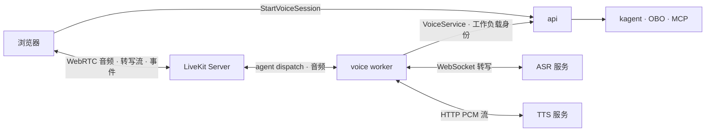

# 语音

语音是可选组件。启用后，听写、朗读与实时通话都经 LiveKit 传输，由 voice worker（LiveKit Agents）完成 VAD、转写、合成与打断；前端仅在启用语音的部署中显示语音入口并加载 LiveKit。



## 语音会话

- `StartVoiceSession` 按听写、朗读或通话模式在 PostgreSQL 记录会话，签发只能加入该房间的 LiveKit 令牌，并通过 agent dispatch 调度 voice worker。
- worker 以 ServiceAccount 投射令牌（受众 `agentos-voice`）调用 api 集群内端口 9093 上的 `VoiceService`，api 经 TokenReview 校验主体，再按房间名取得会话的模式、语言与模型设置。会话到期后请求被拒绝：听写与朗读 2 分钟，通话 30 分钟。
- 通话只能向会话绑定的对话发送消息、读取答复和取消任务，执行身份为发起人，由执行存储续期，权限以发起人为上限。新聊天中发起的通话由首轮创建对话并完成绑定。发起通话需要离线委派。
- 浏览器只持有房间令牌；模型凭据与用户令牌留在服务端。

## 交互

| 模式 | 行为 |
| --- | --- |
| 听写 | 转写流写入输入框，停止后返回最终文本，由用户发送；连接期间缓冲麦克风音频 |
| 朗读 | 从答复 Markdown 提取正文，按语言选择音色，播放结束关闭房间 |
| 通话 | 转写进入绑定对话，答复合成播放；人声打断时取消当前任务及委派，确认取消后发送下一轮 |

通话期间切换会话、切换身份或挂断均释放麦克风与房间。通话最长 30 分钟，并发上限由 `voice.capacity` 配置。

## 模型服务

模型接入页的“语音模型”管理转写与合成服务，模型管理权限可修改服务地址、模型、语言、音色与访问密钥，保存后用于新会话。

- 转写默认接入 Deepgram Live 兼容接口；`protocol: PROTOCOL_WHISPERLIVEKIT` 接入 WhisperLiveKit 原生 `/asr`，保留模型的分词和空格。
- 合成使用 OpenAI 兼容的 `POST /v1/audio/speech` PCM 流；`protocol: PROTOCOL_NEMO` 接入 NeMo-Speech.cpp，以 22050 Hz 单声道 PCM 返回，并传入音色对应的语言。
- `languageCodes` 声明转写语言，聊天页提供语言选择，初始匹配界面语言并记住用户选择；自动识别时省略语言参数。

```yaml
speech:
  transcription:
    endpoint:
      baseUrl: https://speech.example.test/v1
    model: multilingual-asr
    languageCodes: [zh, en]
  synthesis:
    endpoint:
      baseUrl: https://speech.example.test/v1
    voices:
      - {languageCode: zh, model: tts-zh, voice: default}
      - {languageCode: en, model: tts-en, voice: default}
  secretRef: speech-credentials
```

方案 Chart 的初始配置位于 `app_values.agentos.speech`，仅启用一项时另一项保留 `{}`。
Preset 首次创建 `<release>-speech` Secret，用户在模型管理页保存后取得对象所有权，后续预置升级保留配置与凭据。
`configuration.json` 使用 `SpeechConfiguration` 的 proto JSON，配置与凭据在同一 Secret 中原子更新。
合成配置至少包含一个音色，每种语言一个模型和音色，语言代码使用 ISO 639。
`secretRef` 引用已有 Secret，启用转写需要 `transcription-api-key`，启用合成需要 `synthesis-api-key`；管理接口只返回密钥是否配置，留空保留原密钥，显式清除停止使用引用密钥。

## 部署

平台 Chart 以 `voice.enabled` 启用语音，`voice.image` 固定 worker 镜像摘要，`voice.secretRef` 指向包含 LiveKit `api-key` 与 `api-secret` 的 Secret，`voice.capacity` 设置 worker 并发上限。
启用后渲染 worker、语音设置 Preset 与 worker 到 api 的网络策略。

[参考部署](https://github.com/pood1e/agentos-deploy)在安装应用前生成 LiveKit 密钥，使用官方 Chart 安装 LiveKit Server，并复用应用 TLS 域名的 `/livekit`。
信令经 HTTPS/WSS 443，媒体使用节点 UDP 7882 或 TCP 7881，客户端需要能访问媒体地址。外部 LiveKit 通过 `voice.livekitURL`（worker 地址）与 `voice.publicURL`（浏览器地址）接入。

协议见 `proto/agentos/console/v1/speech.proto` 与 `proto/agentos/voice/v1/voice.proto`，worker 位于 `voice/agentos_voice/`。

官方资料：[LiveKit Agents](https://docs.livekit.io/agents/)、[Agent dispatch](https://docs.livekit.io/agents/server/agent-dispatch/)、[轮次与打断](https://docs.livekit.io/agents/logic/turns/)、[自托管网络](https://docs.livekit.io/transport/self-hosting/ports-firewall/)。
