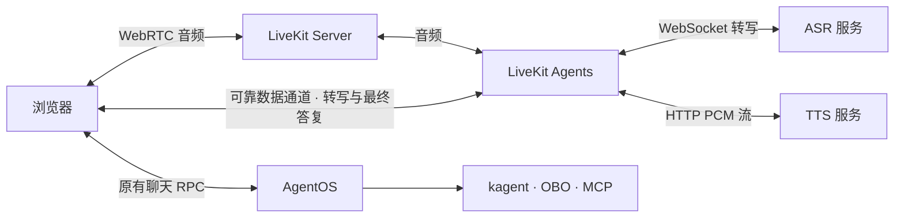

# 实时语音

语音能力按站点启用。普通语音输入与朗读使用 assistant-ui 官方适配器；通话使用 LiveKit Agents、Silero VAD 和 LiveKit 官方浏览器组件。
ASR、TTS 作为独立模型服务接入，协议与凭据复用平台语音配置。

浏览器适配器通过 `@agentos/contracts/shared/browser/` 发布。原生控制台复用同一套听写、PCM 流播放和通话桥接，注入已有 RPC 客户端、身份作用域与聊天发送／取消函数；转写 WebSocket 地址由接入方提供。前端按 `GetSpeechCapabilities` 展示入口，VAD 资源部署在 `/speech-vad/`。

## 交互

- 普通语音输入：Silero VAD 在持续静音 1.4 秒后停止录音，排空转写尾部，将结果保留在输入框。无语音 12 秒或总录音 60 秒时结束。
- 朗读：仅发送最终答复正文。NeMo 以 22050 Hz、单声道 PCM16LE 逐块返回；浏览器在音频时钟上连续排程，保留跨网络块的采样与首尾音频。
- 通话：用户加入私有房间后连续交谈；LiveKit 管理 VAD 和轮次，浏览器将已确认转写交给原聊天入口。检测到持续 200 毫秒的人声时，通过官方 `AgentSession.interrupt()` 停止播放，并取消对应聊天任务及全部委派。旧答复停止朗读；下一句话在取消确认后进入同一会话。最终正文经可靠数据通道交给语音服务流式合成。
- 通话期间关闭普通录音与朗读；切换会话、身份、页面或挂断时释放麦克风与房间。首轮产生聊天 ID 时继续当前通话。发送失败显示显式重试，并复用消息 ID。
- 每次通话最长 30 分钟，默认并发上限为 4。浏览器 45 秒内未加入时回收房间。

## 身份与部署

`StartVoiceCall` 与 `EndVoiceCall` 使用控制台现有身份和同源校验。内部语音 API 使用独立服务令牌；浏览器只取得绑定单个房间的短期 LiveKit 令牌。
模型凭据与用户的 OIDC 令牌留在服务端。转写进入原有聊天和执行链路，用户的应用角色、资源权限与目标系统 OBO 权限继续生效。

在平台 Chart 的 `voice.enabled` 启用通话，`voice.image` 固定语音 worker 镜像摘要；`voice.secretRef` 指向包含 `api-key`、`api-secret`、`api-token` 的 Secret。
部署入口 `deploy/deploy.yaml` 在安装应用前运行 `deploy/voice.yaml`，使用官方 Chart 安装 LiveKit Server，并复用应用的 TLS 域名 `/livekit`。
信令经 HTTPS/WSS 443，媒体使用节点 UDP 7882 或 TCP 7881；客户端需要能访问媒体地址。外部部署可通过 `voice.livekitURL` 与 `voice.publicURL` 提供内部和客户端地址。

协议定义见 `proto/agentos/console/v1/speech.proto` 与 `proto/agentos/voice/v1/worker.proto`；音频适配器和通话管线位于 `voice/agentos_voice/`。
Python 沿用现有 protobuf 7.36.2 与统一生成链。

官方资料：[LiveKit 音频](https://docs.livekit.io/agents/multimodality/audio/)、[轮次与打断](https://docs.livekit.io/agents/logic/turns/)、[自托管网络](https://docs.livekit.io/transport/self-hosting/ports-firewall/)、[浏览器 VAD](https://docs.vad.ricky0123.com/user-guide/api/)。
