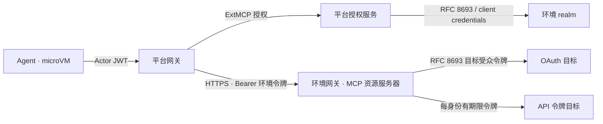

# 接入链路标准化重构

状态：实施与验收中。目标：平台 0.26.0、AIOps 1.23.0。基线：平台 0.25.7（`10d8fa5`），AIOps 方案包 1.22.6。
范围：平台网关、环境网关与连接器之间的传输、认证、凭据和上下文。执行授权、会话隔离与审批语义不变。

## 现状

| 环节 | 现状 | 问题 |
| --- | --- | --- |
| 平台网关 → 环境网关 | NodePort 明文 HTTP；`apiKeyAuthentication` 校验每身份共享密钥；`x-agentos-engineer`、`x-agentos-execution-kind` 选择路由；用户访问令牌经 `x-agentos-subject-token` 转发 | 密钥与用户令牌以明文跨主机传输；执行身份和执行类型依赖自定义请求头 |
| Agent → 平台网关 | 所有请求携带与上一跳同值的身份密钥，工具调用另以 Actor JWT 认证；原生控制器的工具发现只有身份密钥 | 同一静态密钥跨两跳复用 |
| 目标系统凭据 | 每身份静态令牌由部署机生成并写入 Secret；NetBox 读取共用 `mcp-auth`；Kubernetes 服务执行使用静态 ServiceAccount 令牌；Keycloak 客户端密钥经请求头交给连接器换取令牌 | 凭据长期有效；共享账号无法追溯；密钥在调用链上传递 |
| 用户代办 | Kubernetes 使用 RFC 8693，由共用的 `agentos-obo` 客户端发起交换 | 令牌不体现执行 Agent，归因只存在于平台元数据 |
| 连接器协议 | JumpServer MCP 使用 HTTP+SSE 传输 | MCP 规范已由 Streamable HTTP 取代该传输 |
| 治理契约 | 工具分级、身份档案、`approval` 清单为平台契约 | 与 MCP 工具注解分别维护 |

0.25.7 已完成：环境网关路由移除 Actor JWT，以及未配置 `userAuth` 时的用户令牌头；连接器通过 W3C Trace Context 与 Baggage 获得会话、任务和单次工具调用标识，agentgateway 按 MCP SEP-414 同步写入 `_meta`。

## 目标架构

- 跨主机传输使用 TLS，客户端以证书和 SAN 校验环境网关。
- 每次调用携带环境 realm 签发、受众受限、短期有效的 OAuth 访问令牌。发起人取 `sub`，执行身份取 `azp`。
- 平台与环境之间不再使用共享静态密钥和自定义身份请求头。
- 目标系统支持 OAuth 时以令牌交换获取目标凭据；仅支持 API 令牌的目标使用每身份独立、带有效期的令牌。
- 优先复用 agentgateway、Keycloak、cert-manager 与 openid-client 的原生能力。

## 设计

### 传输

- 环境网关 Gateway 使用 HTTPS 监听（Gateway API `protocol: HTTPS`），服务端证书由 cert-manager 签发，SAN 为环境网关地址。
- 平台网关的环境 Backend 配置 `policies.tls`：`caCertificateRefs` 引用签发 CA，`verifySubjectAltNames` 固定环境网关名称。
- 移除明文监听；NetworkPolicy 继续限制来源地址。

### 执行身份与环境令牌

- 身份档案中的每个身份对应环境 realm 的机密客户端 `agentos-<identity>`，启用服务账号与 Standard Token Exchange V2；`catalog` 同样建模为客户端，仅用于工具发现。客户端凭据保存在平台集群 Secret。
- 平台授权服务在 ExtMCP 处理中获取环境令牌并写入 `Authorization`：

  | 请求 | 获取方式 |
  | --- | --- |
  | 用户执行的工具调用 | 以身份客户端为请求方，按 RFC 8693 交换发起人的访问令牌，`audience` 为环境资源标识 |
  | 服务执行的工具调用（定时任务、案例自动化、测评） | 身份客户端的 client credentials（RFC 6749） |
  | 握手与发现 | 当前身份或 `catalog` 客户端的 client credentials |

- 令牌获取使用平台已有的 openid-client。缓存按发起人、身份与环境隔离并在过期前刷新；执行授权撤销后不再使用缓存。
- 工具目录 Backend（`platform-services`）接入同一 ExtMCP 处理器。
- 移除环境网关 API key、`gateway-<identity>` 密钥、`X-Agentos-Engineer` 注入、`x-agentos-execution-kind` 与 `x-agentos-subject-token`。
- Agent 入口以 Actor JWT 认证全部请求。原生控制器的工具发现改用 Kubernetes 绑定 ServiceAccount 令牌，经 P0 验证后移除入口的身份密钥。

### 环境网关

- 以 `traffic.jwtAuthentication.mcp` 校验环境令牌，issuer、audience 与 JWKS 来自 OIDC Discovery；按 RFC 9728 发布受保护资源元数据。
- 路由以路径区分身份：`/mcp/<identity>/<service>`。每条路由的授权规则要求 `jwt.azp` 等于对应身份客户端，工具视图沿用 `mcp.tool.name` 规则。
- 不再按执行类型拆分路由。OAuth 目标统一交换入站令牌，目标侧身份由令牌 `sub` 决定，即发起用户或身份服务账号。
- 环境令牌只在环境网关内使用：OAuth 目标的令牌交换会消费该令牌，API 令牌目标在转发前移除。Actor JWT 移除规则保留。

### 目标系统凭据

| 类别 | 目标 | 方式 |
| --- | --- | --- |
| OAuth 资源 | Kubernetes | 交换为 `<environment>-kubernetes` 受众令牌；RBAC 绑定身份服务账号主体，取消静态 ServiceAccount 令牌 |
| OAuth 资源 | Keycloak Admin API | 交换为 realm 管理受众令牌，权限由 Fine-Grained Admin Permissions V2 决定，用户执行按发起人自身的管理权限执行；Keycloak MCP 直接使用入站令牌，取消客户端密钥转发 |
| 待验证 | Grafana | 原生 JWT 认证接受交换令牌时归入 OAuth 资源，否则按 API 令牌处理 |
| API 令牌 | NetBox、JumpServer、Zammad | 每身份独立账号与令牌，取消 NetBox 共享读取账号；使用目标原生有效期，由部署流程定期轮换 |

API 令牌目标需要在目标侧记录发起人时，连接器 `auth` 以 `oauthTokenExchange` 换取受众为该连接器的令牌，并以 `credentials` 携带目标令牌；连接器按 OIDC Discovery 校验后记录 `sub` 与 `azp`。

### 连接器协议与上下文

- JumpServer MCP 由 HTTP+SSE 切换为 Streamable HTTP，上游 FastAPI-MCP 升级至提供该传输的版本。
- 关联与去重沿用 W3C Trace Context 与 Baggage；发起人与执行身份以令牌声明为准。
- RFC 8693 `act` 委派声明在身份提供方稳定支持后启用，agentgateway 的 `actorToken` 已具备对应能力；此前以 `azp` 标识执行身份。

### 治理契约

- 工具分级、身份档案、`approval` 清单与 `ApprovalService` 保持现有语义。MCP 与 A2A 均未定义工具分级与审批流程。
- 方案包 CI 校验分级与 MCP 工具注解一致：`readOnly`、`managementReadOnly` 中的工具不得声明 `readOnlyHint: false` 或 `destructiveHint: true`。注解只参与一致性检查，访问权限以分级为准，未登记工具仍按写处理。

### 契约与配置

| 对象 | 变更 |
| --- | --- |
| `proto/agentos/governance/v1/governance.proto` 的 `EnvironmentConnection` | 增加 `issuer` 与 `resource`；`resource` 作为环境令牌的 audience |
| `environment_connectors` | 每个目标声明一种原生 BackendAuth；移除 `userAuth` 与按执行类型拆分的路由 |
| `global.agentos.identities` | 字段不变；身份客户端由环境身份部署按档案生成 |
| 站点变量 | 增加环境网关证书与 CA；移除网关密钥目录 |

## 改动范围

| 所属 | 路径 | 改动 |
| --- | --- | --- |
| 平台 | `server/authorization/runtime.ts`、新增环境令牌模块 | ExtMCP 写入环境令牌，移除执行类型与用户令牌请求头 |
| 平台 | `proto/agentos/governance/v1/governance.proto` | 环境连接的 issuer 与 resource |
| 平台 | `environments/templates/gateway.yaml.j2` | HTTPS 监听、证书、MCP 认证与资源元数据；移除 API key 认证与密钥 ConfigMap |
| 平台 | `environments/templates/backends.yaml.j2` | 路径路由、`azp` 授权、目标令牌交换 |
| 平台 | `environments/templates/platform-gateway.yaml.j2`、`platform-services.yaml.j2`、`platform-credentials.yaml.j2` | Backend TLS、目录发现接入 ExtMCP、身份客户端凭据 Secret；移除身份密钥与 `X-Agentos-Engineer` |
| 平台 | `environments/deploy.yaml`、`environments/vars.yaml` | 移除网关密钥生成；证书签发与 CA 下发 |
| 平台 | `ci/check-environments.py` | 校验 TLS、MCP 认证与路由身份绑定，禁止 API key 认证 |
| 平台 | `docs/architecture.md`、`docs/execution-authorization.md`、`docs/environments.md`、`docs/extension.md` | 同步新链路 |
| 方案包 | `environments/connectors.yaml` | 按目标类别重写鉴权 |
| 方案包 | `environments/identity.yaml` | 按身份档案创建 Keycloak 客户端、令牌交换权限与 audience 映射；Kubernetes 认证配置接受身份服务账号令牌 |
| 方案包 | `environments/tasks/mcp-identity.yaml`、`environments/templates/mcp-rbac.yaml.j2` | Kubernetes RBAC 绑定身份服务账号主体，取消静态 ServiceAccount 令牌；NetBox、JumpServer、Zammad 每身份令牌的有效期与轮换；移除 NetBox 共享读取账号 |
| 方案包 | `runtime/keycloak-mcp/http-server.ts` | 使用入站令牌调用 Admin API |
| 方案包 | `runtime/jumpserver-mcp` | Streamable HTTP |
| 方案包 | `ci/` | 工具分级与 MCP 注解一致性检查 |
| 环境 | Keycloak realm、Kubernetes 认证配置、cert-manager | 令牌交换策略、身份服务账号主体、环境网关证书 |

## 实施与切换

### P0 验证

| 验证项 | 通过标准 |
| --- | --- |
| Keycloak 令牌交换 | 服务账号令牌可作为 subject token；交换令牌的 `azp` 为请求方身份客户端，audience 收窄至环境资源 |
| agentgateway MCP 认证 | `traffic.jwtAuthentication.mcp` 与路径路由组合可用，`jwt.azp` 授权生效，环境令牌不进入 API 令牌目标的连接器 |
| Kubernetes | 身份服务账号令牌经 OIDC 认证，RBAC 按主体授权 |
| Keycloak Admin API 与 Grafana | 交换令牌可直接调用 Admin API；Grafana JWT 认证及 mcp-grafana 的令牌转发 |
| JumpServer | 令牌有效期机制；Streamable HTTP 版本与上游兼容 |
| 原生工具发现 | RemoteMCPServer 发现请求可使用 Kubernetes 绑定 ServiceAccount 令牌 |

未通过的目标归入 API 令牌类别，并在本文记录，不引入兼容层。

### P0 结果

- Keycloak 26.8.1：用户与服务账号的两阶段标准令牌交换均通过；保留 `sub`，`azp` 为执行客户端，目标受众收窄。
- agentgateway 1.6.0：`traffic.jwtAuthentication.mcp`、RFC 9728 元数据、路径身份授权与 TLS SAN 校验通过。废弃的 `backend.mcp.authentication` 不再使用。
- Grafana 13.2.4 与官方 MCP 2.0.2：JWT API 认证和 `GRAFANA_FORWARD_HEADERS=Authorization` 透传通过，采用目标令牌交换。
- JumpServer：PrivateToken 没有有效期，改用原生缓存 Bearer token；FastAPI-MCP 0.4.0 与兼容的 MCP SDK 1.30.0 完成 Streamable HTTP 调用验证。
- 原生工具发现：client-go 刷新 transport 和 Go MCP SDK 测试通过，凭据限于平台网关地址。

### 切换

平台与方案包以同一破坏性版本在一个维护窗口内切换：

1. 部署环境身份：创建身份客户端与令牌交换权限，配置 Kubernetes RBAC，签发每身份 API 令牌。
2. 签发环境网关证书，向平台集群写入 CA。
3. 部署环境套件：HTTPS 监听、MCP 认证与路径路由，同一次部署删除 API key 认证与密钥 ConfigMap。
4. 部署平台与方案包新版本。
5. 执行验收。
6. 撤销旧凭据：`gateway-<identity>` 密钥文件与 Secret、Kubernetes 静态令牌、Keycloak MCP 客户端密钥、NetBox 共享读取令牌。

回退时重新部署 0.25.7、1.22.6 及其环境套件，由其部署流程重新生成旧凭据。

## 验收

- 平台与环境之间不存在明文 HTTP；证书或 SAN 校验失败时拒绝连接。
- 环境网关拒绝缺失、过期、audience 错误或 `azp` 与路由身份不符的令牌，不存在 API key 入口。
- Kubernetes 与 Keycloak 的原生审计在用户执行时记录发起人，在服务执行时记录身份服务账号。
- NetBox、JumpServer、Zammad 的每个身份使用独立且有到期时间的令牌，轮换后旧令牌失效。
- 连接器只收到目标凭据或目标受众令牌，不含环境令牌、用户平台令牌与 Actor JWT；W3C 上下文保持不变。
- CI 拒绝工具分级与 MCP 注解冲突的配置。

## 不在本次范围

- 凭据保管由部署机 `.cache/environments/<environment>/secrets` 迁移至专用密钥服务。
- 证书绑定令牌（RFC 8705）与 DPoP（RFC 9449）。
- IETF Transaction Tokens，当前为草案。
- 逐资源业务授权，见[授权实施计划](docs/authorization-plan.md)。

## 参考

- [RFC 8693：OAuth 2.0 Token Exchange](https://www.rfc-editor.org/rfc/rfc8693.html)
- [RFC 8707：Resource Indicators for OAuth 2.0](https://www.rfc-editor.org/rfc/rfc8707.html)
- [RFC 9728：OAuth 2.0 Protected Resource Metadata](https://www.rfc-editor.org/rfc/rfc9728.html)
- [MCP：授权](https://modelcontextprotocol.io/specification/latest/basic/authorization)、[传输](https://modelcontextprotocol.io/specification/latest/basic/transports)与[工具注解](https://modelcontextprotocol.io/specification/latest/server/tools)
- [W3C Trace Context](https://www.w3.org/TR/trace-context/)与 [W3C Baggage](https://www.w3.org/TR/baggage/)
- [Keycloak：Token Exchange](https://www.keycloak.org/securing-apps/token-exchange)
- [agentgateway：标准 Token Exchange](https://agentgateway.dev/docs/kubernetes/latest/documentation/security/backend-authn/token-exchange/standard/)
