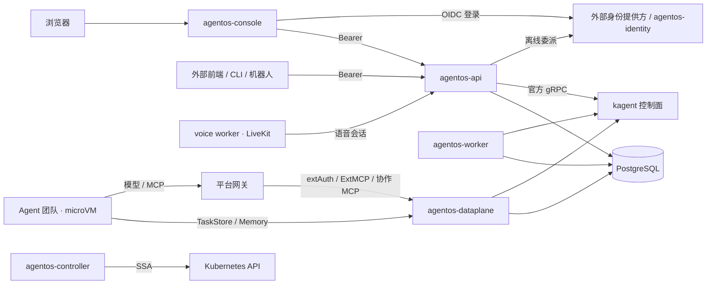

# 架构收敛重构

状态：第三轮方案，替代第二轮未完成的阶段 12–14；前两轮方案与结果见本文件 `902eeb3` 版本。
第二轮已完成合并门禁、容器 CI 与固定工具镜像、knip 入口检查、TokenReview、远程 JWKS 接线与授权配置 Informer 索引；阶段 11 的延迟验收并入单元 5，生产轮换验收不在本轮。

## 目标

- Agent 数据面无单点：鉴权、运行时代理与协作服务独立部署、多副本，进程内不保存业务状态。
- 前端可选：平台 API 只接受 Bearer 令牌，浏览器会话与静态资源独立交付，多个前端共用同一平台 API。
- 状态持久化：执行绑定、凭据与读投影保存在 PostgreSQL，冷启动时长与历史量无关。
- 规则单一来源：工具分级、派生资源与方案预置由控制器统一编译和维护。
- 语音单链路：听写、朗读与通话由 LiveKit 承载。
- 移除轨迹视图：协作画布、MCP 调用图、时间线与执行抽屉。

## 原则

- 每个单元一次切换：数据前向迁移，同一版本删除旧实现，不保留兼容层或双轨实现；迁移 Job 先导出受影响的 schema，回滚为导入导出数据并部署上一版本。
- 复用维护中的组件、官方 SDK 与官方资源类型，平台代码只保留业务语义。
- 模型唯一来源：RPC 与持久化使用 proto；Kubernetes 资源使用 Go 类型生成的 CRD schema，Helm values schema 与 TS 类型由该 schema 生成。
- 依赖方向：前端只经平台 API 访问平台；Agent 只经网关与运行时控制面访问 dataplane；控制器只写 Kubernetes 资源。
- 执行始终受原始发起人的当前授权约束，审批与委派不扩大权限。
- 每个单元同步更新架构、代码导航与交付文档。
- 测试只保留单元与集成测试，不维护浏览器 e2e。

## 现状与目标

| 环节 | 现状 | 目标 | 单元 |
| --- | --- | --- | --- |
| 进程 | `server/platform/main.ts` 单进程承载 BFF、extAuth、ExtMCP、运行时持久化代理、Actor JWKS、协作 MCP、编排与读模型，固定单副本；网关以 `FailClosed` 依赖该进程 | api、dataplane、worker 分离，无状态多副本 | 5 |
| 前端 | SPA、OIDC 回调、Cookie 与 Origin 校验内置于平台 API；外部前端需由方案包复制 API Deployment 接入 | 可选的 console（oauth2-proxy 与静态资源），平台 API 只认 Bearer | 3 |
| 离线委派 | refresh token 只在浏览器登录回调中采集；Bearer 客户端的后台执行随 access token 过期中断 | 平台 API 自有委派流程，任意客户端可引导用户授权 | 3 |
| 默认值 | `identity.mode: none` 为无认证的全权限共享访客；Ingress 固定 traefik | 访客模式改为内置密码身份源，平台只走 OIDC；Gateway API HTTPRoute | 3 |
| 读模型 | 每 2 秒轮询 kagent 并维护全量内存索引；冷启动重放全部历史；部分委派关系按 prompt 文本推断 | PostgreSQL 投影：写路径驱动、定时对账、显式委派关系 | 4 |
| 执行存储 | protobuf 整行 AES-GCM，单一密钥且密文无密钥标识；委派链逐条读取并解密；进程启动时建表 | 绑定按列存储并单次查询取链；凭据信封加密，密文携带密钥标识；版本化迁移 | 2 |
| 工具分级 | 三个 Chart、Ansible 模板、TS 与 Rego 分别推导分级与绑定，运行时解析资源标签 | `AccessPlan` 由控制器编译一次，运行时读取编译结果 | 6 |
| 派生资源 | 连接保存逐个写入派生资源并逆序补偿，无崩溃恢复；预置依赖 Helm `lookup` 与 `resource-policy: keep`，在 `helm template` 下失效 | 控制器 reconcile，API 只写父资源，预置由控制器以 SSA 维护 | 6 |
| 轨迹视图 | 协作画布、MCP 调用图、时间线与执行抽屉 | 删除；系统任务执行记录复用只读会话视图 | 1 |
| 续接 | 以合成用户消息回传子任务结果，结果截断为 180 字或 80 词 | 携带子任务引用与完整结果；上游支持后删除续接 | 4 |
| 语音 | WebSocket 听写与流式 TTS、LiveKit 通话两套链路；通话轮次在浏览器编排 | LiveKit 单链路，轮次在 voice worker 编排 | 7 |
| 交付 | generic package、自定义发布清单与下载器、Python 后置渲染 | OCI 与 cosign、npm 与 PyPI 注册表、Ansible collection、Kustomize | 8 |

## 目标架构

| 组件 | 职责 | 形态 |
| --- | --- | --- |
| agentos-console | oauth2-proxy 浏览器会话、静态 SPA、MCP App 沙箱页 | 可选，独立镜像，可部署多份 |
| agentos-api | Connect RPC、离线委派端点、方案包资源、语音会话签发 | 无状态，多副本 |
| agentos-identity | 内置密码身份源（oidc-provider） | 可选，仅密码模式部署 |
| agentos-dataplane | extAuth、ExtMCP、TaskStore 与 Memory 代理及投影写入、协作 MCP、Actor JWKS | 无状态，多副本，PodDisruptionBudget |
| agentos-worker | 审批协调、续接、投影对账、预置定时任务 | pg-boss 消费者 |
| agentos-controller | AccessPlan 编译、连接派生、方案预置；平台与环境两种模式 | Go，controller-runtime，leader election |
| voice worker | 听写、朗读、通话与轮次编排 | LiveKit Agents |
| PostgreSQL | kagent 与 Substrate 状态、执行绑定与凭据、读投影、任务标签、作业队列、内置身份源的授权数据 | CNPG，版本化迁移 |

## 设计

### 身份与委派

- 平台 API 只接受 `Authorization: Bearer`，校验签名、issuer、audience 与应用角色，不处理浏览器会话与 Origin。
- console 以 oauth2-proxy 承担浏览器会话：授权码与 PKCE，会话 Cookie 为 `SameSite=Lax`，alpha 配置的 `injectRequestHeaders` 把 access token 注入 `Authorization`。跨站写请求不携带会话，Connect 仅对无副作用方法使用 GET。
- 离线委派由平台 API 的 `/delegation/start` 与 `/delegation/callback` 完成：沿用现有机密客户端请求 `offline_access`，`return_to` 限定为登记的前端地址，授权事务保存在短期签名 Cookie 中。凭据按用户主体保存，与发起请求的客户端无关。
- `GetAccessProfile` 返回委派状态与授权地址；无有效委派时 `SendMessage` 返回 `FAILED_PRECONDITION`。console 登录后自动完成委派跳转，CLI 与机器人向用户展示授权地址。
- 访客模式改为内置密码身份源：`identity.mode: password` 时部署 agentos-identity，以 oidc-provider 签发标准令牌。登录页只校验站点密码，令牌主体为单一共享用户并携带全部应用角色与写角色；签名密钥与密码哈希来自 Secret，登录失败限速，授权数据保存在 PostgreSQL。平台 API、console 与离线委派对两种模式使用同一路径。
- 本地开发使用密码模式；多用户隔离用例使用 compose 中的 Keycloak。
- MCP App 沙箱页属于宿主，随 console 交付；平台 API 提供资源读取与工具回调。
- console 与平台 API 以 Gateway API HTTPRoute 暴露，`parentRefs` 由站点提供。

### 执行存储

- `agentos_authorization.execution_bindings` 按列保存会话、发起人、Agent、根会话、父会话、写权限、能力与撤销时间；工具调用以一次递归查询取得完整委派链。
- `agentos_authorization.credentials` 保存 access token 与 refresh token，由 AWS Encryption SDK 的 Raw AES keyring 信封加密：密文头携带密钥名称，multi-keyring 解密旧密钥，加密上下文包含工作空间、记录类型与主体。
- 密钥环由站点提供的 Secret 交付，Chart 不生成密钥。
- 表结构由 golang-migrate 版本化迁移管理，迁移 Job 先于工作负载执行，进程启动不执行 DDL。

### 读投影

- `agentos_read` 保存会话、任务、委派关系与待处理交互，归属过滤、分页与标签筛选在 SQL 中完成。
- 写入来源：
  - dataplane 的 TaskStore 代理在原生写入成功后按任务版本 upsert，只记录状态、调用与交互变化；投影写入失败不影响原生写入。
  - 协作 MCP 在委派时记录父任务、调用与子会话的显式关系，子任务按确定性 messageId 关联。
  - api 记录自身发起的发送、响应、取消与删除。
  - worker 以持久化水位对账 kagent，覆盖 kagent 侧的状态变化。
- 变更经 `pg_notify` 通知各 api 副本的订阅；文本增量只在会话被查看时经 A2A 订阅获取。
- 审批协调与续接作业在投影写入的同一事务内入队 pg-boss。
- 续接消息携带子任务引用与完整结果；kagent [#3244](https://github.com/kagent-dev/kagent/issues/3244) 发布后删除续接协调。

### 进程拆分

| 入口 | 内容 | 就绪条件 |
| --- | --- | --- |
| api | Connect RPC、离线委派端点、方案包资源、语音会话签发 | 数据库与配置 Informer |
| dataplane | extAuth、ExtMCP、TaskStore 与 Memory 代理、协作 MCP、Actor JWKS | 数据库与配置 Informer |
| worker | 审批协调、续接、投影对账、预置定时任务 | 数据库 |
| identity | 内置密码身份源，仅密码模式部署 | 数据库 |

各入口使用同一镜像，各自配置 Service 与 NetworkPolicy：网关与 Agent 运行时只能访问 dataplane，console 与外部客户端只能访问 api 与 identity，worker 无入站。dataplane 至少两副本并配置 PodDisruptionBudget。各入口接入 OpenTelemetry Node SDK，输出授权耗时、kagent 请求速率与进程内存。多节点站点的 CNPG 使用三实例；单节点参考部署覆盖进程故障与滚动发布。

### 平台控制器

- `controller/` 使用 Go 与 controller-runtime，导入 kagent、agentgateway 与 Gateway API 的官方 Go 类型；同一二进制提供平台与环境两种模式，环境模式随 `agentos-environment` Chart 部署。
- `AccessPlan` CRD 承载原 `global.agentos` 中的环境、身份与工具分级。平台模式生成身份读写视图（Backend 与 RemoteMCPServer）、预置角色的工具绑定与路由级策略，编译结果写入 status 供 dataplane 读取；环境模式生成环境网关的 Backend 与认证策略。
- 连接：api 只写父资源（`AgentgatewayModel` 或 `AgentgatewayBackend`）与凭据 Secret；控制器以 SSA 派生 `ModelConfig`、`RemoteMCPServer` 与 `HTTPRoute`，设置 ownerReferences 与状态条件。
- 预置：方案包以 `Preset` 声明原生资源，控制器以独立 field manager 应用。经 API 修改过的对象归用户所有，控制器不再覆盖；未修改的预置随方案包升级更新。
- Chart 不使用 `lookup` 与 `resource-policy: keep`，`helm template` 输出确定，可由 Argo CD 或 Flux 管理。

### 语音

- voice worker 承载听写、朗读与通话：LiveKit 负责音频传输、VAD 与打断，STT 与 TTS 使用 LiveKit Agents 插件。
- `StartVoiceSession` 按听写、朗读或通话模式创建语音会话并签发 LiveKit 令牌。
- 通话轮次在 worker 中编排：worker 以工作负载身份调用 api，只能向语音会话绑定的对话发送消息并读取回答，权限上限为会话发起人。

## 实施单元

### 1 删除轨迹视图（已实现）

删除：

- `src/features/tasks` 中的协作画布、MCP 调用图、时间线、执行抽屉、`flow/`、`TaskView`、`TaskPanel` 与 `use-task`；依赖 `@xyflow/react`、`elkjs` 与 `vis-timeline`。
- RPC `WatchTask`、`GetTaskRun`，消息 `TaskDetail`、`Delegation` 与 `DelegationKind`；`taskDetail`、`server/read-model/views/reviews.ts` 与只供画布使用的委派依赖计算。
- 浏览器 e2e：`tests/e2e`、`playwright.config.ts`、`tests/fake-identity.ts` 与 CI 中的 `e2e` 作业；CI 工具镜像改用 Ubuntu 基础镜像。
- 对应的单元测试、样式变量、文案与文档段落。

聊天内的工具调用、子 Agent 结果、工作中 Agent、审批与任务标签保留。`TaskSummary` 携带根任务的 `agent` 与 `context_id`；系统任务执行记录以只读会话打开，管理员只能读取服务身份发起的会话，`tasks.manage` 持有者维护其标签。

验收：buf lint、Biome、tsc 与 knip 通过；单元与集成测试覆盖共享会话的读取范围、只读状态与标签更新。

### 2 执行存储

删除：`server/authorization/store.ts` 的整行加密、`agentos_authorization.objects` 表与启动建表；`server/tasks/store.ts` 的启动建表；`charts/agentos/templates/execution-secret.yaml` 的密钥生成。迁移 Job 解密旧记录并写入新表后删除旧表。

验收：

- 单次工具调用的委派链校验为一次查询（当前最多 32 次读取与解密）。
- 互换两行密文后解密失败。
- 迁移在 CI 中分别对空库与上一版本数据库执行。

### 3 身份与前端解耦

新增 console 镜像、委派端点与密码模式的 identity 入口。

删除：

- `server/authorization/browser.ts`，由委派端点替代；`server/platform/access.ts` 的 Origin 校验与访客主体；`identity.mode: none`。
- 平台 API 镜像中的前端产物与静态托管；`server/mcp-apps/sandbox.ts` 移入 console。
- `charts/agentos/templates/console-ingress.yaml` 与 `sandbox-ingress.yaml`。
- 方案包的 `environments/clients.yaml` 与 `environments/tasks/client-api.yaml`；Controller UI 对平台会话 Cookie 的绑定。

验收：

- 同一平台 API 同时服务 AgentOS console、Controller UI 与 CLI。
- 浏览器退出与 access token 过期后后台任务继续；身份提供方撤销离线会话后，一个 access token 有效期内拒绝后续调用。
- 跨站写请求与 WebSocket 不携带会话；错误的 issuer、audience 与未登记的 `return_to` 被拒绝。
- 密码模式下 console、CLI 与后台任务使用与外部身份提供方相同的授权路径；连续输错密码触发限速。
- console 发版不重启平台 API。

### 4 读投影

删除：`server/read-model` 的 `sync`、`live`、`index`、`checkpoints`、`observation`、`page` 与内存视图，`decode/` 保留为投影写入的解析；`server/jobs/coordination.ts` 的启动全量入队与 checkpoint 订阅；`server/team-sessions/continuation.ts` 的结果截断与语言判断。切换时由 Job 从 kagent 回填投影。

验收：

- 就绪时长与进程内存不随任务量增长，与切换前同等任务量对比。
- 平台对 kagent 的请求速率与活动量相关，与历史量无关。
- 运行时写入 1 秒内可见，kagent 侧变化在对账周期内可见。
- 越权读取的负例保持拒绝；测试中的委派关系全部按 ID 解析。

### 5 进程拆分

`server/platform/main.ts` 拆为 `server/apps/{api,dataplane,worker}.ts`；Chart 为三个入口分别生成 Deployment、Service 与 NetworkPolicy；网关 extAuth、ExtMCP、协作 MCP 后端与 kagent `controlPlaneUrl` 指向 dataplane；各入口接入 OpenTelemetry Node SDK。验证 agentgateway 远程 JWKS 能否经 BackendTLSPolicy 直连 `ate-idp-server`，可行则删除 9092 中转。

删除：单进程入口、`console-service.yaml` 的多端口 Service、启动路径上的 `automation.seed`（改为 worker 单例作业）。

验收：

- 负载下逐个终止任意 Pod，模型与 MCP 调用无超出网关重试的失败，审批与续接不丢失。
- api 滚动发布不影响 dataplane；console 流式负载下 dataplane 授权 p99 不劣于切换前。
- 各角色 NetworkPolicy 的负例通过。

### 6 平台控制器

切换前导出受影响资源；迁移按现有对象与方案预置的差异判定预置归属，并把派生资源的字段所有权移交控制器。

删除：

- `server/management/{changes,bindings,mcp-services,credential-references}.ts` 与 `connections.ts` 的派生写入，错误类型 `management.partialSave`。
- `server/governance/bindings.ts` 的标签解析。
- `charts/agentos/templates/{_environment-tools,_presets}.tpl`、`charts/agentos-connections/templates/identity-views.yaml`、`charts/agentos-environment/templates/backends.yaml` 的分级推导，以及 Chart 中全部 `lookup` 与 `resource-policy: keep`。
- `environments/templates/initialize-service-tools.yaml.j2` 与 `environments/connect.yaml` 的绑定追加。
- `tests/policies/tools.rego` 的分级推导，保留跨资源 audience、主体、路由覆盖与越权不变量。
- `scripts/generate-environment-schema.mjs` 与手写 `values.schema.json` 中由 CRD schema 覆盖的部分；Gateway 级拼接的 CEL。

验收：

- 现有站点配置迁移前后的渲染资源语义一致，差异逐条列明。
- reconcile 中途终止后收敛；连接保存为单次写入。
- 用户修改过的预置在方案包升级后保留，未修改的预置随之更新。
- 跨身份、只读写入、未知工具与同名跨服务工具的授权负例保持拒绝。

### 7 语音单链路

删除：RPC `TranscribeAudio`、`SynthesizeSpeech`、`StartVoiceCall` 与 `EndVoiceCall`；`server/speech` 的 WebSocket 转写代理与合成流；`shared/browser/speech` 与 `shared/browser/voice/chat-bridge.ts`；依赖 `@deepgram/sdk`、`@ricky0123/vad-web`、`@fastify/websocket` 与 `ws`。

验收：

- 听写首个转写片段、朗读首段音频与通话打断的延迟不劣于切换前。
- 页面切到后台或短暂断网后通话继续。
- worker 向未绑定对话发送消息、使用过期语音会话或越过发起人权限的请求被拒绝。

### 8 交付

- 镜像与 Chart 使用 OCI 并以 cosign 签名，安装前验签；npm 与 Python 契约发布到 GitLab 注册表；参考部署交付 Ansible collection。
- 上游 Chart 的资源补丁改用 Kustomize post-renderer。

删除：generic package 发布、`deployment.tar.gz`、`proto/agentos/distribution/v1` 发布清单与 `ci/` 中对应的打包、清单和发布脚本；`deploy/gateway/kagent-post-renderer.py` 与 `deploy/microvm/substrate-post-renderer.py`；消费方的 `platform.lock.json`、`fetch-platform.py`、`scripts/fetch-agentos-contracts.mjs` 与 `agentos-contracts.lock.json`。

验收：干净环境从注册表完成安装与升级；篡改或错版本的制品被拒绝；同一版本的镜像、Chart、包与 collection 来自同一源码提交。

### 上游收敛

独立推进；所选发布版本包含对应能力且站点回归通过后删除本地实现。

- kagent [#3244](https://github.com/kagent-dev/kagent/issues/3244) 发布后删除续接协调。
- kagent 补丁按 MemoryService 身份范围、Actor 身份头、Harness 工具约束与准备策略提交上游。
- kagent 公开 HITL 与工具调用元数据协议后删除 `proto/agentos/kagent/v1/wire.proto`。
- Substrate [#2159](https://github.com/agent-substrate/substrate/pull/2159) 与启动出站修复进入发布版本后删除 `runtime/substrate/golden-skills.patch`。

## 实施顺序

| 单元 | 依赖 | 可并行 |
| --- | --- | --- |
| 1 删除轨迹视图 | — | 2、6 |
| 2 执行存储 | — | 1、6 |
| 3 身份与前端解耦 | 2 | 6 |
| 4 读投影 | 1、2 | 6、7 |
| 5 进程拆分 | 3、4 | 6、7 |
| 6 平台控制器 | — | 1–5、7 |
| 7 语音单链路 | 3 | 4–6 |
| 8 交付 | 6 | — |

每个单元合并后发布并完成验收，依赖它的单元随后开始。

## 评估后保留

| 项 | 理由 |
| --- | --- |
| kagent 单一服务用户（`KAGENT_USER_ID`） | 会话归属与隔离由执行绑定和投影承担，kagent 用户字段不参与授权 |
| pg-boss | 复用执行库承载审批协调与续接，平台不引入 Temporal |
| 案例自动化的 Temporal 与 NATS JetStream | 环境侧可选组件，与平台协调不重叠 |
| `tests/fake-kagent` | 真实 kagent 依赖 KVM 与 microVM；录制替身覆盖接口契约，真实链路由运行时 CI 验证 |
| `src/lib/use-watch.ts` | TanStack Query 的流式查询仍是实验接口 |
| 平台内置嵌入模型 | 离线可用，资源占用固定 |
| Connect RPC、assistant-ui、shadcn/ui、rjsf、openid-client、jose、MCP SDK、Kubernetes Informer | 已是维护中的官方或主流组件 |

## 范围

本轮不包含：

- 逐资源业务 ACL，见[授权实施计划](docs/authorization-plan.md)。
- CNPG 持续备份，以及执行凭据与 Actor 签名密钥的轮换演练。
- kagent 与 Substrate 的版本升级，按上游发布独立验证。
- 平台外测评。

## 风险

| 风险 | 处理 |
| --- | --- |
| 密码模式为单一共享主体，没有用户隔离 | 与原访客模式的共享语义一致；需要隔离的站点使用外部身份提供方 |
| 离线委派增加一次授权跳转 | 沿用原机密客户端，存量离线授权直接迁移；console 登录后自动完成 |
| 投影遗漏 kagent 侧的状态变化 | worker 对账兜底，验收记录最大陈旧时间 |
| 新增 Go 控制器 | 复用现有 Go 与 envtest 工具链；分级规则只在控制器中实现 |
| oauth2-proxy alpha 配置随版本变化 | 固定版本，配置纳入 Chart 测试 |
| LiveKit 听写的建连延迟 | 页面打开时预连，验收首个转写片段延迟 |
| 前向迁移不可逆 | 迁移 Job 先导出受影响的 schema；回滚为导入导出数据并部署上一版本 |
| 方案包与 Controller UI 依赖平台契约 | 契约变更随单元发布，消费方在同一切换窗口升级 |

## 依据

- [oauth2-proxy alpha 配置](https://oauth2-proxy.github.io/oauth2-proxy/configuration/alpha-config)、[OAuth 2.0 for Browser-Based Applications](https://datatracker.ietf.org/doc/draft-ietf-oauth-browser-based-apps/)、[OIDC offline_access](https://openid.net/specs/openid-connect-core-1_0.html#OfflineAccess)、[oidc-provider](https://github.com/panva/node-oidc-provider)
- [AWS Encryption SDK Raw AES keyring](https://docs.aws.amazon.com/encryption-sdk/latest/developer-guide/use-raw-aes-keyring.html)、[multi-keyring](https://docs.aws.amazon.com/encryption-sdk/latest/developer-guide/use-multi-keyring.html)、[golang-migrate](https://github.com/golang-migrate/migrate)
- [PostgreSQL NOTIFY](https://www.postgresql.org/docs/current/sql-notify.html)、[pg-boss](https://github.com/timgit/pg-boss)、[OpenTelemetry JavaScript](https://opentelemetry.io/docs/languages/js/)
- [controller-runtime](https://github.com/kubernetes-sigs/controller-runtime)、[Server-Side Apply](https://kubernetes.io/docs/reference/using-api/server-side-apply/)、[垃圾回收与 ownerReferences](https://kubernetes.io/docs/concepts/architecture/garbage-collection/)、[Helm lookup](https://helm.sh/docs/chart_template_guide/functions_and_pipelines/#using-the-lookup-function)
- [Gateway API HTTPRoute](https://gateway-api.sigs.k8s.io/api-types/httproute/)、[LiveKit Agents](https://docs.livekit.io/agents/)
- [Helm 3 OCI](https://helm.sh/docs/v3/topics/registries/)、[cosign](https://github.com/sigstore/cosign)、[GitLab npm](https://docs.gitlab.com/user/packages/npm_registry/) 与 [PyPI](https://docs.gitlab.com/user/packages/pypi_repository/) 注册表、[Kustomize](https://kubernetes.io/docs/tasks/manage-kubernetes-objects/kustomization/)、[Helm post-rendering](https://helm.sh/docs/v3/topics/advanced/#post-rendering)、[Ansible collection 安装](https://docs.ansible.com/ansible/latest/collections_guide/collections_installing.html)
